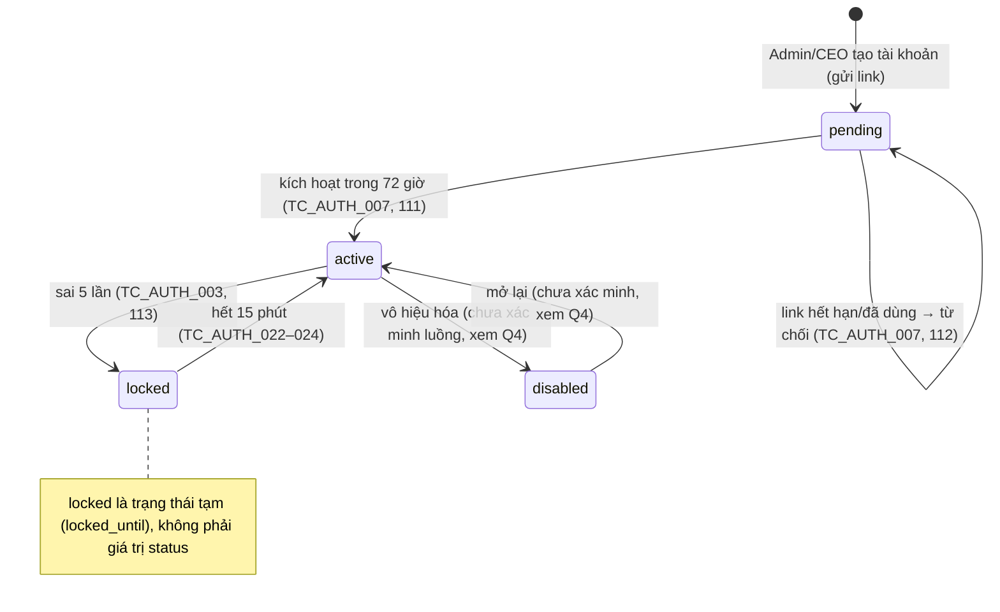
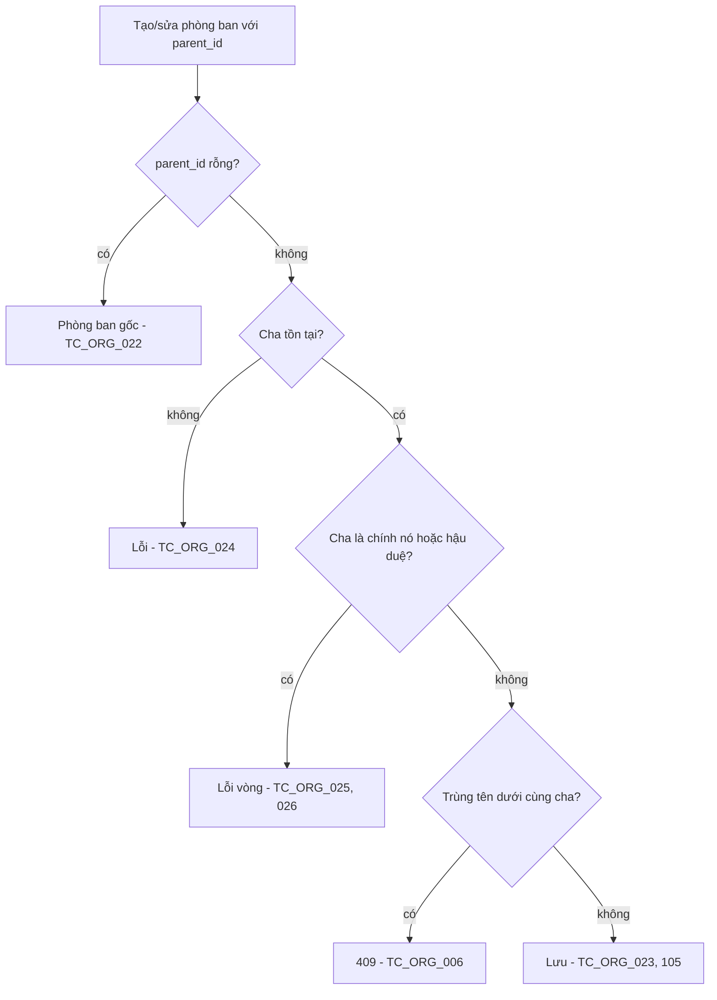
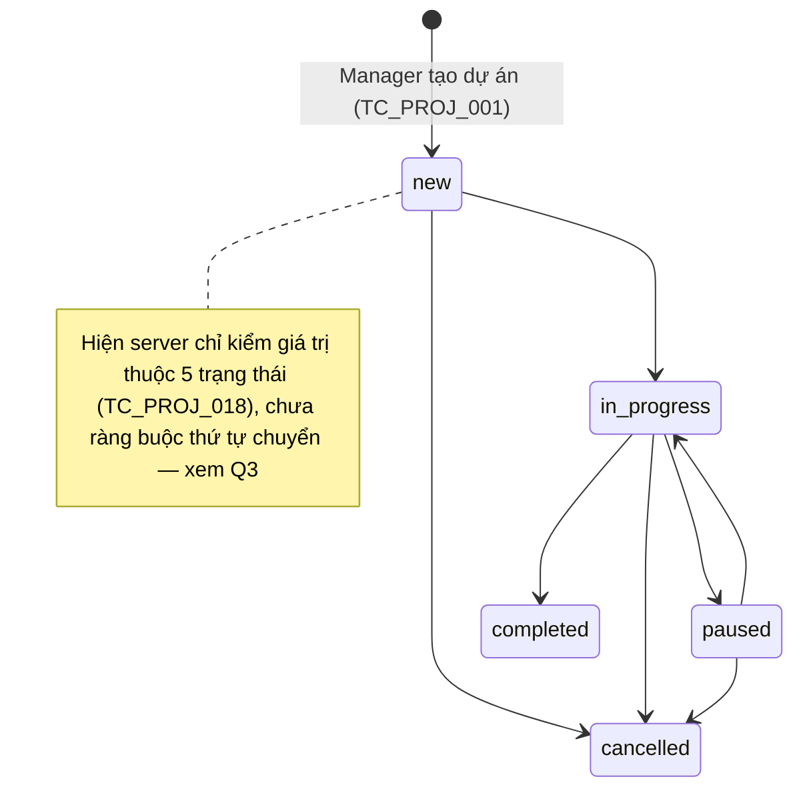
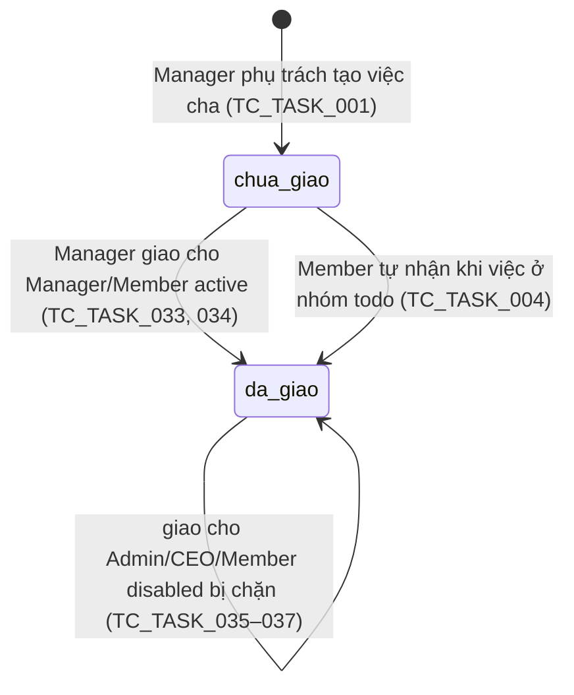

```mermaid
stateDiagram-v2
    [*] --> todo
    todo --> in_progress: có luật (TC_KANBAN_017, 032); tính WIP
    in_progress --> cho_nghiem_thu: Member/Manager (TC_KANBAN_018)
    cho_nghiem_thu --> done: chỉ Manager (TC_KANBAN_019, 037)
    in_progress --> done: chỉ Manager; Member bị chặn (TC_KANBAN_034, 102)
    in_progress --> todo: có luật (TC_KANBAN_040)
    done --> in_progress: Manager mở lại, tính WIP (TC_KANBAN_020)
    done --> todo: Manager mở lại (TC_KANBAN_038); Member bị chặn (TC_KANBAN_035)
    note right of cho_nghiem_thu: "Chờ nghiệm thu" thuộc nhóm in_progress (§5 quy tắc 5)
```

# Bảng test case — WorkTrack (CF-01 → CF-06)

- Ngày: **2026-11-27**
- Nhánh: `test/test-cases`
- Commit gốc: `13333ea` (nhánh `feature/kanban`)
- Chuẩn áp dụng: `docs/testing/test-design-standard.md` (bài giảng Kiểm thử phần mềm HCM-UTE)
- Lần chạy tự động: `docs/testing/runs/20261126-2233-after.md` (1150 test, 0 fail). Ca thủ công chạy bằng Playwright MCP, ảnh ở `docs/testing/evidence/ui/`
- Bản CSV cùng nội dung: `docs/testing/test-cases.csv` (cột đầu là Chức năng)

## Tổng hợp theo module

| Module | Mã CF | Số ca | Tự động | Thủ công | Pass | Fail | Chưa chạy |
|---|---|---|---|---|---|---|---|
| AUTH — Đăng nhập, phiên và tài khoản | CF-01 | 49 | 35 | 14 | 49 | 0 | 0 |
| ORG — Tổ chức: nhân sự, phòng ban, chức danh, kỹ năng | CF-02 | 38 | 33 | 5 | 38 | 0 | 0 |
| PROJ — Dự án, cột Kanban và luật chuyển | CF-03 | 43 | 39 | 4 | 43 | 0 | 0 |
| KANBAN — Bảng Kanban, luật chuyển cột và giới hạn WIP | CF-04, CF-05 | 51 | 47 | 4 | 51 | 0 | 0 |
| TASK — Công việc cha, Story Point, nhãn, người được giao | CF-06 | 45 | 41 | 4 | 45 | 0 | 0 |
| **Tổng** | | **226** | **195** | **31** | **226** | **0** | **0** |

Theo loại ca: Dương 68, Âm 63, Biên 75, Bảo mật 20. Tỷ lệ tự động hóa: 195/226 = 86.3%.

Quy ước: ca `_0xx` là ca tự động (unit/API/integration/UI component), ca `_1xx` là ca thủ công trên app thật. Cột **Test tự động** ghi đúng tên test trong `summary.json` của lần chạy (Go: `TestTên/ca_con`; frontend: tên describe + it). Mật khẩu, token không ghi vào tài liệu hay ảnh.

## Mục lục

1. [AUTH — Đăng nhập, phiên và tài khoản (CF-01)](#1-auth)
2. [ORG — Tổ chức: nhân sự, phòng ban, chức danh, kỹ năng (CF-02)](#2-org)
3. [PROJ — Dự án, cột Kanban và luật chuyển (CF-03)](#3-proj)
4. [KANBAN — Bảng Kanban, luật chuyển cột và giới hạn WIP (CF-04, CF-05)](#4-kanban)
5. [TASK — Công việc cha, Story Point, nhãn, người được giao (CF-06)](#5-task)
6. [Câu hỏi cần làm rõ](#cau-hoi-can-lam-ro)

## 1. AUTH — Đăng nhập, phiên và tài khoản (CF-01)

### a) Điều kiện kiểm thử

| Mã điều kiện | Điều kiện | Nguồn | Số ca |
|---|---|---|---|
| TCond_AUTH_01 | Đăng nhập bằng email (chuẩn hóa cắt trắng, viết thường) + mật khẩu đúng cấp access token và cookie refresh an toàn | CF-01, UC01, B4 | 7 |
| TCond_AUTH_02 | Sai thông tin đăng nhập trả lỗi chung, không lộ email có tồn tại | CF-01, B6 | 2 |
| TCond_AUTH_03 | Sai 5 lần liên tiếp khóa 15 phút; mốc mở khóa tính chính xác | B8 | 7 |
| TCond_AUTH_04 | Access token 15 phút; refresh 7 ngày xoay vòng, dùng lại token cũ thu hồi cả họ | B4 | 3 |
| TCond_AUTH_05 | Đăng xuất thu hồi refresh token và xóa cookie | B4 | 2 |
| TCond_AUTH_06 | Link kích hoạt dùng một lần, hết hạn sau 72 giờ; kích hoạt chuyển pending → active | CF-01, UC02, B7 | 4 |
| TCond_AUTH_07 | Quyền theo vai trò: Admin/CEO quản lý tài khoản; Admin không tạo dự án; Member chỉ nhận việc | CLAUDE.md §5 quy tắc 1, 3; B2 | 9 |
| TCond_AUTH_08 | Route guard và sidebar theo vai trò; chặn chuyển hướng ra ngoài | CLAUDE.md §5 quy tắc 1 | 5 |
| TCond_AUTH_09 | Mật khẩu ≥ 8 ký tự (đếm theo rune), có chữ và số, tối đa 72 byte (giới hạn bcrypt) | B8 | 9 |
| TCond_AUTH_10 | Chỉ tài khoản active được đăng nhập; pending, disabled bị chặn | CF-01, UC01 | 6 |

### b) Thiết kế

**Phân vùng tương đương và giá trị biên**

| Biến | Lớp hợp lệ | Lớp không hợp lệ | Giá trị biên | Mã TC |
|---|---|---|---|---|
| Độ dài mật khẩu (rune) | ≥ 8 | < 8 | 7 / 8 | TC_AUTH_010, TC_AUTH_011, TC_AUTH_016 |
| Độ dài mật khẩu (byte) | ≤ 72 | > 72 | 72 / 73 (ASCII và đa byte) | TC_AUTH_012, TC_AUTH_013, TC_AUTH_017 |
| Thành phần mật khẩu | có chữ và số | chỉ chữ; chỉ số | — | TC_AUTH_014, TC_AUTH_015, TC_AUTH_110 |
| Số lần sai liên tiếp | < 5 | ≥ 5 (khóa) | 4 / 5; lần 6 đúng vẫn khóa | TC_AUTH_003, TC_AUTH_113 |
| Thời điểm so với locked_until | ≥ mốc (hết khóa) | < mốc (còn khóa) | mốc−1s / mốc / mốc+1s | TC_AUTH_022–025 |
| Tuổi link kích hoạt | ≤ 72 giờ, chưa dùng | > 72 giờ; đã dùng | 72 giờ | TC_AUTH_007, TC_AUTH_112 |
| Trạng thái tài khoản | active | pending; disabled; giá trị lạ | — | TC_AUTH_018–021, TC_AUTH_114 |
| Mã vai trò | admin, manager, member, ceo | viết hoa; rỗng; lạ | rỗng | TC_AUTH_027–030 |
| Token | hợp lệ, chưa hết hạn | sai chữ ký; sai thuật toán; hết hạn; thu hồi | — | TC_AUTH_004, TC_AUTH_005 |

**Bảng quyết định**

Bảng quyết định quyền theo vai trò (TCond_AUTH_07, TC_AUTH_032–035, TC_AUTH_008):

| Điều kiện / Hành động | Luật 1 | Luật 2 | Luật 3 | Luật 4 |
|---|---|---|---|---|
| Vai trò | Admin | Manager | Member | CEO |
| Tạo dự án | F | **T** | F | F |
| Nhận việc | F | F | **T** | F |
| Quản lý tài khoản | **T** | F | F | **T** |
| Gọi /users | 2xx | 403 | 403 | 2xx |

Bảng quyết định đăng nhập (TCond_AUTH_02, 03, 10):

| Điều kiện | L1 | L2 | L3 | L4 | L5 |
|---|---|---|---|---|---|
| Email tồn tại | T | T | T | T | F |
| Mật khẩu đúng | T | F | T | T | – |
| Trạng thái active | T | T | F (pending/disabled) | T | – |
| Đang bị khóa | F | F | F | T | – |
| **Kết quả** | 200 + token | 401 chung, tăng đếm | 403 chưa kích hoạt / bị vô hiệu | 423/429 + Retry-After | 401 chung |
| Mã TC | 001, 101–104 | 002, 105 | 019, 020, 114 | 003, 113 | 002, 105 |

**Sơ đồ trạng thái / luồng**

Ca phủ chuyển trạng thái: active đăng nhập được (018), pending bị chặn (019, 114), disabled bị chặn (020, 009). Phiên refresh: hợp lệ → xoay vòng; dùng lại → thu hồi cả họ (004).

**Use case**

UC01 Đăng nhập: luồng chính TC_AUTH_001, 101–104, 108; luồng phụ sai thông tin TC_AUTH_002, 105, 106; khóa TC_AUTH_113; chưa kích hoạt TC_AUTH_114; đăng xuất TC_AUTH_006, 107. UC02 Kích hoạt: luồng chính TC_AUTH_109 → 111; luồng phụ mật khẩu yếu TC_AUTH_110, link đã dùng TC_AUTH_112, hết hạn TC_AUTH_007.

**Checklist bảo mật và đoán lỗi**

| Hạng mục | Mã TC | Nội dung kiểm |
|---|---|---|
| IDOR | — | Không áp dụng (không có tài nguyên theo id ở CF-01 ngoài /users, đã phủ ở ma trận quyền TC_AUTH_008) |
| Token | TC_AUTH_004, 005, 009, 107 | Sai chữ ký/thuật toán/hết hạn/thu hồi; dùng lại refresh; disabled sau đăng nhập; Back sau đăng xuất |
| Cookie | TC_AUTH_001 | HttpOnly, Secure, SameSite=Strict |
| Lộ thông tin | TC_AUTH_002, 105 | Cùng một thông báo cho sai mật khẩu và email không tồn tại |
| Dò mật khẩu | TC_AUTH_003, 113 | Khóa 15 phút, 429 + Retry-After, đếm đúng khi đồng thời |
| Open redirect | TC_AUTH_009 | next=//evil bị bỏ qua |
| Bấm hai lần | TC_AUTH_006, 004 | Nút đăng xuất khóa; refresh single-flight |
| XSS / SQLi | TC_AUTH_031 | Email chuẩn hóa; truy vấn qua sqlc tham số hóa |
| Token trong URL/ảnh | TC_AUTH_007, 109 | Token kích hoạt bị xóa khỏi URL; ảnh minh chứng đã che token |

**Phủ 4 vai trò**

| Vai trò | Mã TC |
|---|---|
| Admin | TC_AUTH_008, 009, 032, 101, 109 |
| Manager | TC_AUTH_008, 009, 033, 102 |
| Member | TC_AUTH_008, 009, 034, 103 |
| CEO | TC_AUTH_008, 009, 035, 104 |

### c) Bảng test case

| Mã TC | Mô tả | Điều kiện kiểm thử | Kỹ thuật | Tiền điều kiện | Dữ liệu kiểm thử | Các bước | Kết quả mong đợi | Tiêu chí Pass/Fail | Kết quả thực tế | Trạng thái | Ưu tiên | Loại | Hình thức | Test tự động | Minh chứng | Bug |
|---|---|---|---|---|---|---|---|---|---|---|---|---|---|---|---|---|
| TC_AUTH_001 | Đăng nhập đúng trả access token và cookie refresh an toàn | TCond_AUTH_01 | EP (lớp hợp lệ) | — | Email + mật khẩu đúng của tài khoản active (seed B11) | Chạy test tự động tương ứng (scripts/test-cases.sh) | 200, access token 15 phút; cookie refresh HttpOnly, Secure, SameSite=Strict; giao diện về trang next, sidebar theo vai trò | Pass khi kết quả trả về trùng kết quả mong đợi và test tự động pass; ngược lại Fail | Đúng như mong đợi | Pass | Cao | Dương | Tự động (API + UI) | TestLogin_Valid_ReturnsTokenAndSecureCookie_CF01; Đăng nhập [CF-01][UC01] đúng → về trang next và sidebar theo vai trò | docs/testing/runs/20261126-2233-after.md | — |
| TC_AUTH_002 | Sai thông tin đăng nhập trả lỗi chung, không lộ email tồn tại | TCond_AUTH_02 | EP (lớp không hợp lệ), đoán lỗi | — | Mật khẩu sai; email không tồn tại | Chạy test tự động tương ứng (scripts/test-cases.sh) | 401 INVALID_CREDENTIALS, cùng một thông báo; giao diện ở lại trang đăng nhập | Pass khi kết quả trả về trùng kết quả mong đợi và test tự động pass; ngược lại Fail | Đúng như mong đợi | Pass | Cao | Âm | Tự động (API + UI) | TestLogin_Errors_MapToHTTP_CF01; Đăng nhập [CF-01][UC01] sai mật khẩu → hiện thông báo của máy chủ, ở lại trang | docs/testing/runs/20261126-2233-after.md | — |
| TC_AUTH_003 | Sai 5 lần thì khóa 15 phút, kể cả khi gửi đồng thời | TCond_AUTH_03 | BVA (4/5 lần), đoán lỗi (đồng thời) | — | 5 lần sai liên tiếp; nhiều request song song | Chạy test tự động tương ứng (scripts/test-cases.sh) | Lần 5 khóa tài khoản 15 phút; trả 429/423 kèm Retry-After; đếm đúng khi đồng thời | Pass khi kết quả trả về trùng kết quả mong đợi và test tự động pass; ngược lại Fail | Đúng như mong đợi | Pass | Cao | Biên | Tự động (unit + API + integration) | TestLogin_WrongPassword_FiveTimesLocks_CF01_B8; TestLogin_LockedByConcurrentRequest_ReturnsLocked_CF01_B8; TestLogin_TooManyRequests_Returns429WithRetryAfter_CF01; TestUserRepo_RegisterLoginFailure_Concurrent_CF01_B8 | docs/testing/runs/20261126-2233-after.md | — |
| TC_AUTH_004 | Refresh token xoay vòng; dùng lại token cũ thu hồi cả họ token | TCond_AUTH_04 | Chuyển trạng thái, đoán lỗi | — | Refresh hợp lệ; refresh đã dùng; hai refresh đồng thời | Chạy test tự động tương ứng (scripts/test-cases.sh) | Refresh hợp lệ cấp cookie mới; token cũ dùng lại → thu hồi cả họ; client chỉ gửi một refresh khi gọi đồng thời | Pass khi kết quả trả về trùng kết quả mong đợi và test tự động pass; ngược lại Fail | Đúng như mong đợi | Pass | Cao | Dương | Tự động (unit + API + UI) | TestRefresh_WithCookie_RotatesCookie_CF01; TestRefresh_ReuseRevokesFamily_CF01_B4; TestRefresh_ConcurrentUseRevokesFamily_CF01_B4; session refresh single-flight: gọi đồng thời chỉ gửi một request (refresh token xoay vòng) | docs/testing/runs/20261126-2233-after.md | — |
| TC_AUTH_005 | Token sai chữ ký, hết hạn hoặc đã thu hồi bị từ chối | TCond_AUTH_04 | EP (lớp không hợp lệ) | — | JWT sai chữ ký, sai thuật toán, hết hạn; refresh hết hạn/thu hồi | Chạy test tự động tương ứng (scripts/test-cases.sh) | 401 và xóa cookie; /me trả 401 khi không có hoặc sai token | Pass khi kết quả trả về trùng kết quả mong đợi và test tự động pass; ngược lại Fail | Đúng như mong đợi | Pass | Cao | Âm | Tự động (unit + API) | TestJWT_Verify_RejectsBadTokens_CF01_B4; TestRefresh_Invalid_Returns401AndClearsCookie_CF01; TestRefreshToken_ExpiredRevoked_CF01_B4; TestMe_AuthMatrix_CF01 | docs/testing/runs/20261126-2233-after.md | — |
| TC_AUTH_006 | Đăng xuất thu hồi refresh token; bấm hai lần chỉ gọi API một lần | TCond_AUTH_05 | Đoán lỗi (bấm hai lần) | — | Phiên đang đăng nhập | Chạy test tự động tương ứng (scripts/test-cases.sh) | Refresh bị thu hồi, cookie bị xóa; nút đăng xuất khóa khi đang xử lý | Pass khi kết quả trả về trùng kết quả mong đợi và test tự động pass; ngược lại Fail | Đúng như mong đợi | Pass | Cao | Dương | Tự động (API + UI) | TestLogout_RevokesAndClearsCookie_CF01; Đăng xuất [CF-01] đang đăng xuất → nút bị khóa, bấm lần hai không gọi API lần nữa | docs/testing/runs/20261126-2233-after.md | — |
| TC_AUTH_007 | Kích hoạt tài khoản bằng link 72 giờ | TCond_AUTH_06 | BVA (72 giờ), chuyển trạng thái | — | Token hợp lệ; token hết hạn sau 72 giờ | Chạy test tự động tương ứng (scripts/test-cases.sh) | Hợp lệ: đặt mật khẩu, pending → active, token bị xóa khỏi URL; hết hạn: báo lỗi của máy chủ | Pass khi kết quả trả về trùng kết quả mong đợi và test tự động pass; ngược lại Fail | Đúng như mong đợi | Pass | Cao | Dương | Tự động (unit + API + UI) | TestActivationVerify_CF01; TestActivate_CF01; TestActivate_Expired72h_CF01_B7; Kích hoạt tài khoản [CF-01][UC02] token hợp lệ → xóa token khỏi URL, đặt mật khẩu, toast và về /login; Kích hoạt tài khoản [CF-01][UC02] token hết hạn → hiện thông báo của máy chủ | docs/testing/runs/20261126-2233-after.md | — |
| TC_AUTH_008 | Ma trận quyền quản lý tài khoản theo vai trò | TCond_AUTH_07 | Bảng quyết định | — | 4 vai trò × endpoint /users; CEO tạo CEO; email trùng | Chạy test tự động tương ứng (scripts/test-cases.sh) | Admin và CEO quản lý tài khoản; Manager, Member bị 403; CEO tạo được CEO; email trùng bị 409 | Pass khi kết quả trả về trùng kết quả mong đợi và test tự động pass; ngược lại Fail | Đúng như mong đợi | Pass | Cao | Dương | Tự động (unit + API) | TestUsersEndpoints_RoleMatrix_CF01; TestCan_Matrix_CF01_B2; TestCreateUser_CEOCreatesCEO_Returns201_CF01; TestCreateUser_DuplicateEmail_CF01 | docs/testing/runs/20261126-2233-after.md | — |
| TC_AUTH_009 | Route guard, sidebar theo vai trò và chặn chuyển hướng ra ngoài | TCond_AUTH_08 | Bảng quyết định, đoán lỗi (open redirect) | — | Chưa đăng nhập; Manager vào /admin/users; next=//evil; tài khoản bị khóa sau khi đăng nhập | Chạy test tự động tương ứng (scripts/test-cases.sh) | Chưa đăng nhập → /login?next=…; không đủ quyền → trạng thái không có quyền; next ngoài bị bỏ qua; tài khoản disabled → 401 | Pass khi kết quả trả về trùng kết quả mong đợi và test tự động pass; ngược lại Fail | Đúng như mong đợi | Pass | Cao | Bảo mật | Tự động (API + UI) | Route guard [CF-01] chưa đăng nhập vào trang trong → chuyển /login kèm next; Route guard [CF-01] Manager gõ thẳng /admin/users → trạng thái không có quyền nêu vai trò; Đăng nhập [CF-01][UC01] next trỏ ra ngoài (//evil) → bị bỏ qua, về trang của tôi; Đăng nhập [CF-01][UC01] bỏ trống → báo lỗi dưới ô, không gọi API; Sidebar theo vai trò [CF-01] admin thấy đúng các mục; Sidebar theo vai trò [CF-01] ceo thấy đúng các mục; Sidebar theo vai trò [CF-01] manager thấy đúng các mục; Sidebar theo vai trò [CF-01] member thấy đúng các mục; TestMe_AccountDisabledAfterLogin_Returns401_CF01 | docs/testing/runs/20261126-2233-after.md | — |
| TC_AUTH_010 | Mật khẩu 7 ký tự bị từ chối | TCond_AUTH_09 | BVA (min−1) | — | "abcdef1" (7) | Chạy test tự động tương ứng (scripts/test-cases.sh) | ErrPasswordTooWeak | Pass khi kết quả trả về trùng kết quả mong đợi và test tự động pass; ngược lại Fail | Đúng như mong đợi | Pass | Cao | Biên | Tự động (unit) | TestTC_AUTH_PasswordBVA_CF01/TC_AUTH_010_7_ky_tu | docs/testing/runs/20261126-2233-after.md | — |
| TC_AUTH_011 | Mật khẩu đúng 8 ký tự có chữ và số được chấp nhận | TCond_AUTH_09 | BVA (min) | — | "abcdefg1" (8) | Chạy test tự động tương ứng (scripts/test-cases.sh) | Không lỗi | Pass khi kết quả trả về trùng kết quả mong đợi và test tự động pass; ngược lại Fail | Đúng như mong đợi | Pass | Cao | Biên | Tự động (unit) | TestTC_AUTH_PasswordBVA_CF01/TC_AUTH_011_8_ky_tu | docs/testing/runs/20261126-2233-after.md | — |
| TC_AUTH_012 | Mật khẩu 72 byte được chấp nhận | TCond_AUTH_09 | BVA (max của bcrypt) | — | 70 chữ + "1a" = 72 byte | Chạy test tự động tương ứng (scripts/test-cases.sh) | Không lỗi | Pass khi kết quả trả về trùng kết quả mong đợi và test tự động pass; ngược lại Fail | Đúng như mong đợi | Pass | Cao | Biên | Tự động (unit) | TestTC_AUTH_PasswordBVA_CF01/TC_AUTH_012_72_byte | docs/testing/runs/20261126-2233-after.md | — |
| TC_AUTH_013 | Mật khẩu 73 byte bị từ chối | TCond_AUTH_09 | BVA (max+1) | — | 73 byte ASCII | Chạy test tự động tương ứng (scripts/test-cases.sh) | ErrPasswordTooWeak | Pass khi kết quả trả về trùng kết quả mong đợi và test tự động pass; ngược lại Fail | Đúng như mong đợi | Pass | Cao | Biên | Tự động (unit) | TestTC_AUTH_PasswordBVA_CF01/TC_AUTH_013_73_byte | docs/testing/runs/20261126-2233-after.md | — |
| TC_AUTH_014 | Mật khẩu chỉ có chữ bị từ chối | TCond_AUTH_09 | EP (thiếu số) | — | "abcdefgh" | Chạy test tự động tương ứng (scripts/test-cases.sh) | ErrPasswordTooWeak | Pass khi kết quả trả về trùng kết quả mong đợi và test tự động pass; ngược lại Fail | Đúng như mong đợi | Pass | Cao | Âm | Tự động (unit) | TestTC_AUTH_PasswordBVA_CF01/TC_AUTH_014_chi_chu | docs/testing/runs/20261126-2233-after.md | — |
| TC_AUTH_015 | Mật khẩu chỉ có số bị từ chối | TCond_AUTH_09 | EP (thiếu chữ) | — | "12345678" | Chạy test tự động tương ứng (scripts/test-cases.sh) | ErrPasswordTooWeak | Pass khi kết quả trả về trùng kết quả mong đợi và test tự động pass; ngược lại Fail | Đúng như mong đợi | Pass | Cao | Âm | Tự động (unit) | TestTC_AUTH_PasswordBVA_CF01/TC_AUTH_015_chi_so | docs/testing/runs/20261126-2233-after.md | — |
| TC_AUTH_016 | Mật khẩu tiếng Việt 8 ký tự (đếm theo rune) được chấp nhận | TCond_AUTH_09 | EP (Unicode) | — | "Mậtkhẩu1" | Chạy test tự động tương ứng (scripts/test-cases.sh) | Không lỗi | Pass khi kết quả trả về trùng kết quả mong đợi và test tự động pass; ngược lại Fail | Đúng như mong đợi | Pass | Cao | Dương | Tự động (unit) | TestTC_AUTH_PasswordBVA_CF01/TC_AUTH_016_tieng_viet_8_rune | docs/testing/runs/20261126-2233-after.md | — |
| TC_AUTH_017 | Mật khẩu đa byte vượt 72 byte bị từ chối | TCond_AUTH_09 | BVA (byte, không phải rune) | — | 24×"ệ" + "1a" = 73 byte | Chạy test tự động tương ứng (scripts/test-cases.sh) | ErrPasswordTooWeak | Pass khi kết quả trả về trùng kết quả mong đợi và test tự động pass; ngược lại Fail | Đúng như mong đợi | Pass | Cao | Biên | Tự động (unit) | TestTC_AUTH_PasswordBVA_CF01/TC_AUTH_017_73_byte_da_byte | docs/testing/runs/20261126-2233-after.md | — |
| TC_AUTH_018 | Tài khoản active được đăng nhập | TCond_AUTH_10 | Chuyển trạng thái | — | status=active | Chạy test tự động tương ứng (scripts/test-cases.sh) | Không lỗi | Pass khi kết quả trả về trùng kết quả mong đợi và test tự động pass; ngược lại Fail | Đúng như mong đợi | Pass | Cao | Dương | Tự động (unit) | TestTC_AUTH_AccountState_CF01/TC_AUTH_018_active | docs/testing/runs/20261126-2233-after.md | — |
| TC_AUTH_019 | Tài khoản pending bị chặn đăng nhập | TCond_AUTH_10 | Chuyển trạng thái | — | status=pending | Chạy test tự động tương ứng (scripts/test-cases.sh) | ErrAccountNotActive | Pass khi kết quả trả về trùng kết quả mong đợi và test tự động pass; ngược lại Fail | Đúng như mong đợi | Pass | Cao | Âm | Tự động (unit) | TestTC_AUTH_AccountState_CF01/TC_AUTH_019_pending | docs/testing/runs/20261126-2233-after.md | — |
| TC_AUTH_020 | Tài khoản disabled bị chặn đăng nhập | TCond_AUTH_10 | Chuyển trạng thái | — | status=disabled | Chạy test tự động tương ứng (scripts/test-cases.sh) | ErrAccountDisabled | Pass khi kết quả trả về trùng kết quả mong đợi và test tự động pass; ngược lại Fail | Đúng như mong đợi | Pass | Cao | Âm | Tự động (unit) | TestTC_AUTH_AccountState_CF01/TC_AUTH_020_disabled | docs/testing/runs/20261126-2233-after.md | — |
| TC_AUTH_021 | Trạng thái lạ bị từ chối khi đọc | TCond_AUTH_10 | EP (lớp không hợp lệ) | — | ParseUserStatus("locked") | Chạy test tự động tương ứng (scripts/test-cases.sh) | ErrInvalidUserStatus | Pass khi kết quả trả về trùng kết quả mong đợi và test tự động pass; ngược lại Fail | Đúng như mong đợi | Pass | Cao | Âm | Tự động (unit) | TestTC_AUTH_AccountState_CF01/TC_AUTH_021_status_la | docs/testing/runs/20261126-2233-after.md | — |
| TC_AUTH_022 | Trước mốc mở khóa 1 giây vẫn bị khóa | TCond_AUTH_03 | BVA (mốc−1s) | — | locked_until = now + 1s | Chạy test tự động tương ứng (scripts/test-cases.sh) | Còn khóa | Pass khi kết quả trả về trùng kết quả mong đợi và test tự động pass; ngược lại Fail | Đúng như mong đợi | Pass | Cao | Biên | Tự động (unit) | TestTC_AUTH_LockWindow_CF01/TC_AUTH_022_truoc_moc_1s | docs/testing/runs/20261126-2233-after.md | — |
| TC_AUTH_023 | Đúng mốc mở khóa thì hết khóa | TCond_AUTH_03 | BVA (mốc) | — | locked_until = now | Chạy test tự động tương ứng (scripts/test-cases.sh) | Hết khóa | Pass khi kết quả trả về trùng kết quả mong đợi và test tự động pass; ngược lại Fail | Đúng như mong đợi | Pass | Cao | Biên | Tự động (unit) | TestTC_AUTH_LockWindow_CF01/TC_AUTH_023_dung_moc | docs/testing/runs/20261126-2233-after.md | — |
| TC_AUTH_024 | Sau mốc mở khóa thì hết khóa | TCond_AUTH_03 | BVA (mốc+1s) | — | locked_until = now − 1s | Chạy test tự động tương ứng (scripts/test-cases.sh) | Hết khóa | Pass khi kết quả trả về trùng kết quả mong đợi và test tự động pass; ngược lại Fail | Đúng như mong đợi | Pass | Cao | Biên | Tự động (unit) | TestTC_AUTH_LockWindow_CF01/TC_AUTH_024_sau_moc | docs/testing/runs/20261126-2233-after.md | — |
| TC_AUTH_025 | Chưa từng bị khóa thì không khóa | TCond_AUTH_03 | EP | — | locked_until = nil | Chạy test tự động tương ứng (scripts/test-cases.sh) | Không khóa | Pass khi kết quả trả về trùng kết quả mong đợi và test tự động pass; ngược lại Fail | Đúng như mong đợi | Pass | Cao | Dương | Tự động (unit) | TestTC_AUTH_LockWindow_CF01/TC_AUTH_025_chua_tung_khoa | docs/testing/runs/20261126-2233-after.md | — |
| TC_AUTH_026 | Hằng số chính sách khớp quyết định B7/B8 | TCond_AUTH_03 | Kiểm tra cấu hình | — | MaxFailedLogins, LoginLockDuration, ActivationTokenTTL | Chạy test tự động tương ứng (scripts/test-cases.sh) | 5; 15 phút; 72 giờ | Pass khi kết quả trả về trùng kết quả mong đợi và test tự động pass; ngược lại Fail | Đúng như mong đợi | Pass | Cao | Dương | Tự động (unit) | TestTC_AUTH_LockWindow_CF01/TC_AUTH_026_hang_so_chinh_sach | docs/testing/runs/20261126-2233-after.md | — |
| TC_AUTH_027 | Bốn mã vai trò hợp lệ được chấp nhận | TCond_AUTH_07 | EP (4 lớp hợp lệ) | — | admin, manager, member, ceo | Chạy test tự động tương ứng (scripts/test-cases.sh) | Không lỗi | Pass khi kết quả trả về trùng kết quả mong đợi và test tự động pass; ngược lại Fail | Đúng như mong đợi | Pass | Cao | Dương | Tự động (unit) | TestTC_AUTH_RoleAndEmail_CF01/TC_AUTH_027_vai_tro_hop_le_admin; TestTC_AUTH_RoleAndEmail_CF01/TC_AUTH_027_vai_tro_hop_le_manager; TestTC_AUTH_RoleAndEmail_CF01/TC_AUTH_027_vai_tro_hop_le_member; TestTC_AUTH_RoleAndEmail_CF01/TC_AUTH_027_vai_tro_hop_le_ceo | docs/testing/runs/20261126-2233-after.md | — |
| TC_AUTH_028 | Mã vai trò viết hoa bị từ chối | TCond_AUTH_07 | EP (không hợp lệ) | — | "Admin" | Chạy test tự động tương ứng (scripts/test-cases.sh) | ErrInvalidRole | Pass khi kết quả trả về trùng kết quả mong đợi và test tự động pass; ngược lại Fail | Đúng như mong đợi | Pass | Cao | Âm | Tự động (unit) | TestTC_AUTH_RoleAndEmail_CF01/TC_AUTH_028_vai_tro_viet_hoa | docs/testing/runs/20261126-2233-after.md | — |
| TC_AUTH_029 | Mã vai trò rỗng bị từ chối | TCond_AUTH_07 | BVA (rỗng) | — | "" | Chạy test tự động tương ứng (scripts/test-cases.sh) | ErrInvalidRole | Pass khi kết quả trả về trùng kết quả mong đợi và test tự động pass; ngược lại Fail | Đúng như mong đợi | Pass | Cao | Biên | Tự động (unit) | TestTC_AUTH_RoleAndEmail_CF01/TC_AUTH_029_vai_tro_rong | docs/testing/runs/20261126-2233-after.md | — |
| TC_AUTH_030 | Mã vai trò lạ bị từ chối | TCond_AUTH_07 | EP (không hợp lệ), đoán lỗi | — | "superadmin" | Chạy test tự động tương ứng (scripts/test-cases.sh) | ErrInvalidRole | Pass khi kết quả trả về trùng kết quả mong đợi và test tự động pass; ngược lại Fail | Đúng như mong đợi | Pass | Cao | Âm | Tự động (unit) | TestTC_AUTH_RoleAndEmail_CF01/TC_AUTH_030_vai_tro_la | docs/testing/runs/20261126-2233-after.md | — |
| TC_AUTH_031 | Email được chuẩn hóa: cắt khoảng trắng, viết thường | TCond_AUTH_01 | EP | — | "  An.Nguyen@WorkTrack.LOCAL " | Chạy test tự động tương ứng (scripts/test-cases.sh) | "an.nguyen@worktrack.local" | Pass khi kết quả trả về trùng kết quả mong đợi và test tự động pass; ngược lại Fail | Đúng như mong đợi | Pass | Cao | Dương | Tự động (unit) | TestTC_AUTH_RoleAndEmail_CF01/TC_AUTH_031_chuan_hoa_email | docs/testing/runs/20261126-2233-after.md | — |
| TC_AUTH_032 | Admin: không tạo dự án, không nhận việc, được quản lý tài khoản | TCond_AUTH_07 | Bảng quyết định (luật 1) | — | role=admin | Chạy test tự động tương ứng (scripts/test-cases.sh) | CreateProject=F, ClaimTask=F, ManageUsers=T | Pass khi kết quả trả về trùng kết quả mong đợi và test tự động pass; ngược lại Fail | Đúng như mong đợi | Pass | Cao | Dương | Tự động (unit) | TestTC_AUTH_RoleWritePermissions_CF01/TC_AUTH_032_admin | docs/testing/runs/20261126-2233-after.md | — |
| TC_AUTH_033 | Manager: tạo dự án, không nhận việc, không quản lý tài khoản | TCond_AUTH_07 | Bảng quyết định (luật 2) | — | role=manager | Chạy test tự động tương ứng (scripts/test-cases.sh) | CreateProject=T, ClaimTask=F, ManageUsers=F | Pass khi kết quả trả về trùng kết quả mong đợi và test tự động pass; ngược lại Fail | Đúng như mong đợi | Pass | Cao | Dương | Tự động (unit) | TestTC_AUTH_RoleWritePermissions_CF01/TC_AUTH_033_manager | docs/testing/runs/20261126-2233-after.md | — |
| TC_AUTH_034 | Member: chỉ nhận việc | TCond_AUTH_07 | Bảng quyết định (luật 3) | — | role=member | Chạy test tự động tương ứng (scripts/test-cases.sh) | CreateProject=F, ClaimTask=T, ManageUsers=F | Pass khi kết quả trả về trùng kết quả mong đợi và test tự động pass; ngược lại Fail | Đúng như mong đợi | Pass | Cao | Dương | Tự động (unit) | TestTC_AUTH_RoleWritePermissions_CF01/TC_AUTH_034_member | docs/testing/runs/20261126-2233-after.md | — |
| TC_AUTH_035 | CEO: quyền Admin (quản lý tài khoản), không tạo dự án | TCond_AUTH_07 | Bảng quyết định (luật 4) | — | role=ceo | Chạy test tự động tương ứng (scripts/test-cases.sh) | CreateProject=F, ClaimTask=F, ManageUsers=T | Pass khi kết quả trả về trùng kết quả mong đợi và test tự động pass; ngược lại Fail | Đúng như mong đợi | Pass | Cao | Dương | Tự động (unit) | TestTC_AUTH_RoleWritePermissions_CF01/TC_AUTH_035_ceo | docs/testing/runs/20261126-2233-after.md | — |
| TC_AUTH_101 | Admin đăng nhập, thấy menu quản trị | TCond_AUTH_01, TCond_AUTH_08 | EP, use case UC01 | App chạy ở môi trường dev (make dev), dữ liệu seed B11 | Tài khoản Admin seed (mật khẩu không ghi vào tài liệu) | 1. Mở /login 2. Nhập email, mật khẩu 3. Bấm Đăng nhập | Vào trang chủ, sidebar có mục Quản trị | Pass khi giao diện và phản hồi máy chủ khớp kết quả mong đợi (đối chiếu ảnh); ngược lại Fail | Đúng như mong đợi | Pass | Cao | Dương | Thủ công (Playwright MCP) | — | docs/testing/evidence/ui/TC_AUTH_101.png | — |
| TC_AUTH_102 | Manager đăng nhập, thấy menu dự án | TCond_AUTH_01, TCond_AUTH_08 | EP, use case UC01 | App chạy ở môi trường dev (make dev), dữ liệu seed B11 | Tài khoản Manager seed | Như TC_AUTH_101 | Sidebar có Dự án, không có Quản trị | Pass khi giao diện và phản hồi máy chủ khớp kết quả mong đợi (đối chiếu ảnh); ngược lại Fail | Đúng như mong đợi | Pass | Cao | Dương | Thủ công (Playwright MCP) | — | docs/testing/evidence/ui/TC_AUTH_102.png | — |
| TC_AUTH_103 | Member đăng nhập, thấy Công việc của tôi | TCond_AUTH_01, TCond_AUTH_08 | EP, use case UC01 | App chạy ở môi trường dev (make dev), dữ liệu seed B11 | Tài khoản Member seed | Như TC_AUTH_101 | Sidebar có Công việc của tôi, không có Quản trị | Pass khi giao diện và phản hồi máy chủ khớp kết quả mong đợi (đối chiếu ảnh); ngược lại Fail | Đúng như mong đợi | Pass | Cao | Dương | Thủ công (Playwright MCP) | — | docs/testing/evidence/ui/TC_AUTH_103.png | — |
| TC_AUTH_104 | CEO đăng nhập, thấy Dashboard và Quản trị | TCond_AUTH_01, TCond_AUTH_08 | EP, use case UC01 | App chạy ở môi trường dev (make dev), dữ liệu seed B11 | Tài khoản CEO seed | Như TC_AUTH_101 | Sidebar có Dashboard và mục Quản trị / Nhân sự & phòng ban (B2) | Pass khi giao diện và phản hồi máy chủ khớp kết quả mong đợi (đối chiếu ảnh); ngược lại Fail | Đúng như mong đợi; xem Câu hỏi cần làm rõ Q1 | Pass | Cao | Dương | Thủ công (Playwright MCP) | — | docs/testing/evidence/ui/TC_AUTH_104.png | — |
| TC_AUTH_105 | Sai mật khẩu và email không tồn tại cùng một thông báo | TCond_AUTH_02 | EP (không hợp lệ), đoán lỗi (dò email) | App chạy ở môi trường dev (make dev), dữ liệu seed B11 | Mật khẩu sai; email không tồn tại | 1. Nhập email đúng + mật khẩu sai 2. Nhập email không tồn tại | Cả hai hiện "Email hoặc mật khẩu không đúng" | Pass khi giao diện và phản hồi máy chủ khớp kết quả mong đợi (đối chiếu ảnh); ngược lại Fail | Đúng như mong đợi | Pass | Cao | Âm | Thủ công (Playwright MCP) | — | docs/testing/evidence/ui/TC_AUTH_105-1.png; docs/testing/evidence/ui/TC_AUTH_105-2.png | — |
| TC_AUTH_106 | Bỏ trống/ sai định dạng bị chặn ở client | TCond_AUTH_01 | EP (không hợp lệ) | App chạy ở môi trường dev (make dev), dữ liệu seed B11 | Ô trống; email "abc" | 1. Bấm Đăng nhập khi trống 2. Nhập email sai định dạng | Lỗi dưới ô, không có request /auth/login | Pass khi giao diện và phản hồi máy chủ khớp kết quả mong đợi (đối chiếu ảnh); ngược lại Fail | Đúng như mong đợi | Pass | Cao | Âm | Thủ công (Playwright MCP) | — | docs/testing/evidence/ui/TC_AUTH_106-1.png; docs/testing/evidence/ui/TC_AUTH_106-2.png | — |
| TC_AUTH_107 | Đăng xuất rồi Back hoặc gõ URL đều về /login | TCond_AUTH_05 | Chuyển trạng thái, đoán lỗi | App chạy ở môi trường dev (make dev), dữ liệu seed B11; đã đăng nhập | — | 1. Bấm Đăng xuất 2. Bấm Back 3. Gõ URL trang trong | Luôn về /login | Pass khi giao diện và phản hồi máy chủ khớp kết quả mong đợi (đối chiếu ảnh); ngược lại Fail | Đúng như mong đợi | Pass | Cao | Bảo mật | Thủ công (Playwright MCP) | — | docs/testing/evidence/ui/TC_AUTH_107-1.png; docs/testing/evidence/ui/TC_AUTH_107-2.png | — |
| TC_AUTH_108 | F5 vẫn giữ phiên nhờ refresh cookie | TCond_AUTH_04 | Chuyển trạng thái | App chạy ở môi trường dev (make dev), dữ liệu seed B11; đã đăng nhập | — | 1. Bấm F5 | Vẫn ở trang hiện tại, không phải đăng nhập lại | Pass khi giao diện và phản hồi máy chủ khớp kết quả mong đợi (đối chiếu ảnh); ngược lại Fail | Đúng như mong đợi | Pass | Cao | Dương | Thủ công (Playwright MCP) | — | docs/testing/evidence/ui/TC_AUTH_108.png | — |
| TC_AUTH_109 | Admin tạo tài khoản, email kích hoạt tới Mailpit | TCond_AUTH_06 | Use case UC02 | App chạy ở môi trường dev (make dev), dữ liệu seed B11; Admin đã đăng nhập | Họ tên, email mới, vai trò Member | 1. Thêm nhân sự 2. Mở Mailpit | Tài khoản pending; Mailpit có email chứa link kích hoạt (token đã che) | Pass khi giao diện và phản hồi máy chủ khớp kết quả mong đợi (đối chiếu ảnh); ngược lại Fail | Đúng như mong đợi | Pass | Cao | Dương | Thủ công (Playwright MCP) | — | docs/testing/evidence/ui/TC_AUTH_109-1.png; docs/testing/evidence/ui/TC_AUTH_109-2.png | — |
| TC_AUTH_110 | Đặt mật khẩu chỉ có chữ bị báo lỗi | TCond_AUTH_09 | EP (không hợp lệ) | Có link kích hoạt hợp lệ | Mật khẩu chỉ chữ | 1. Mở link 2. Nhập mật khẩu chỉ chữ | Báo lỗi yêu cầu có chữ và số | Pass khi giao diện và phản hồi máy chủ khớp kết quả mong đợi (đối chiếu ảnh); ngược lại Fail | Đúng như mong đợi | Pass | Cao | Âm | Thủ công (Playwright MCP) | — | docs/testing/evidence/ui/TC_AUTH_110.png | — |
| TC_AUTH_111 | Kích hoạt thành công rồi đăng nhập được | TCond_AUTH_06, TCond_AUTH_10 | Chuyển trạng thái pending → active | Có link kích hoạt hợp lệ | Mật khẩu hợp lệ (không ghi) | 1. Đặt mật khẩu 2. Đăng nhập | Toast thành công, về /login; đăng nhập được | Pass khi giao diện và phản hồi máy chủ khớp kết quả mong đợi (đối chiếu ảnh); ngược lại Fail | Đúng như mong đợi | Pass | Cao | Dương | Thủ công (Playwright MCP) | — | docs/testing/evidence/ui/TC_AUTH_111-1.png; docs/testing/evidence/ui/TC_AUTH_111-2.png | — |
| TC_AUTH_112 | Dùng lại link kích hoạt đã dùng bị từ chối | TCond_AUTH_06 | Chuyển trạng thái, đoán lỗi | Link đã dùng ở TC_AUTH_111 | Link cũ | 1. Mở lại link | Báo link không hợp lệ | Pass khi giao diện và phản hồi máy chủ khớp kết quả mong đợi (đối chiếu ảnh); ngược lại Fail | Đúng như mong đợi | Pass | Cao | Âm | Thủ công (Playwright MCP) | — | docs/testing/evidence/ui/TC_AUTH_112.png | — |
| TC_AUTH_113 | Sai 5 lần bị khóa; lần 6 nhập đúng vẫn bị khóa | TCond_AUTH_03 | BVA (4/5/6 lần) | App chạy ở môi trường dev (make dev), dữ liệu seed B11 | Tài khoản thử; mật khẩu sai 5 lần rồi đúng | 1. Nhập sai 5 lần 2. Nhập đúng | Lần 1–4: 401; lần 5: 423 khóa 15 phút; lần 6 (đúng): vẫn 423 | Pass khi giao diện và phản hồi máy chủ khớp kết quả mong đợi (đối chiếu ảnh); ngược lại Fail | Đúng như mong đợi | Pass | Cao | Biên | Thủ công (Playwright MCP) | — | docs/testing/evidence/ui/TC_AUTH_113-1.png; docs/testing/evidence/ui/TC_AUTH_113-2.png | — |
| TC_AUTH_114 | Tài khoản chưa kích hoạt bị từ chối | TCond_AUTH_10 | Chuyển trạng thái | Tài khoản pending | Email pending | 1. Đăng nhập | Từ chối với thông báo chung | Pass khi giao diện và phản hồi máy chủ khớp kết quả mong đợi (đối chiếu ảnh); ngược lại Fail | Đúng như mong đợi | Pass | Cao | Âm | Thủ công (Playwright MCP) | — | docs/testing/evidence/ui/TC_AUTH_114.png | — |

## 2. ORG — Tổ chức: nhân sự, phòng ban, chức danh, kỹ năng (CF-02)

### a) Điều kiện kiểm thử

| Mã điều kiện | Điều kiện | Nguồn | Số ca |
|---|---|---|---|
| TCond_ORG_01 | Endpoint tổ chức chỉ Admin/CEO ghi; Admin không tạo/sửa tài khoản CEO | CF-02, B2, CLAUDE.md §5 quy tắc 1 | 5 |
| TCond_ORG_02 | Tên phòng ban/chức danh/kỹ năng: 1–100 ký tự sau khi gộp khoảng trắng | CF-02 | 7 |
| TCond_ORG_03 | Kỹ năng của nhân sự: 0–50 mục, mức hợp lệ (chữ thường), không trùng | CF-02 | 7 |
| TCond_ORG_04 | Cây phòng ban: cha phải tồn tại, không tạo vòng, không trùng tên dưới cùng cha | CF-02 | 7 |
| TCond_ORG_05 | Danh sách nhân sự phân trang (mặc định 20, tối đa 100), lọc/tìm kiếm tham số hóa | B9 | 9 |
| TCond_ORG_06 | Hồ sơ nhân sự: email duy nhất, không đổi khi sửa; validate phía client | CF-02, CF-01 | 4 |

### b) Thiết kế

**Phân vùng tương đương và giá trị biên**

| Biến | Lớp hợp lệ | Lớp không hợp lệ | Giá trị biên | Mã TC |
|---|---|---|---|---|
| Độ dài tên | 1–100 ký tự | 0; chỉ khoảng trắng; > 100 | 0 / 1 / 100 / 101 | TC_ORG_010–015 |
| Số kỹ năng | 0–50 | > 50 | 0 / 50 / 51 | TC_ORG_016–018 |
| Mức kỹ năng | mã chữ thường hợp lệ | viết hoa; rỗng | rỗng | TC_ORG_019, TC_ORG_020 |
| Phòng ban cha | nil; id tồn tại | không tồn tại; chính nó; cháu | — | TC_ORG_022–026 |
| pageSize | 1–100 | ≤ 0 (về 20); > 100 (kẹp 100) | 0 / 1 / 100 / 101 | TC_ORG_027–030 |
| page | ≥ 1 | 0 (về 1); vượt trần (kẹp) | 0 / trần+1 | TC_ORG_031, TC_ORG_032 |
| Email | duy nhất | trùng; sai định dạng | — | TC_ORG_007, TC_ORG_009, TC_ORG_102 |
| Chuỗi tìm kiếm | chữ thường | ký tự đặc biệt SQL (%, _, ', --) | — | TC_ORG_003, TC_ORG_033 |

**Bảng quyết định**

Bảng quyết định quyền tổ chức (TCond_ORG_01):

| Điều kiện / Hành động | Admin | CEO | Manager | Member |
|---|---|---|---|---|
| Đọc/ghi phòng ban, chức danh, kỹ năng, nhân sự | T | T | 403 | 403 |
| Tạo/sửa tài khoản vai trò CEO | **F** (ẩn trong form, 403 ở server) | T | – | – |
| Mở /admin/users trên giao diện | T | T | không có quyền | không có quyền |
| Mã TC | 001, 008, 101, 103 | 001, 008 | 001, 104 | 001, 104 |

**Sơ đồ trạng thái / luồng**

**Use case**

Quản trị nhân sự (CF-02): xem danh sách và tab quản trị TC_ORG_101; thêm nhân sự trùng email TC_ORG_102; chọn vai trò TC_ORG_103; xem cây phòng ban TC_ORG_105; truy cập trái phép TC_ORG_104.

**Checklist bảo mật và đoán lỗi**

| Hạng mục | Mã TC | Nội dung kiểm |
|---|---|---|
| IDOR / quyền | TC_ORG_001, 008, 104 | Manager, Member 403; Admin không sửa CEO |
| SQLi | TC_ORG_003, 033 | Tìm kiếm tham số hóa, escape %, _ (convert.go likeContains + ESCAPE trong app_user.sql) |
| Token | TC_ORG_001 | Không token → 401 |
| Hai người cùng sửa | TC_ORG_006, 007 | Ràng buộc UNIQUE ở CSDL trả 409 |
| XSS | TC_ORG_015 | Tên lưu dạng văn bản, React escape khi hiển thị |

**Phủ 4 vai trò**

| Vai trò | Mã TC |
|---|---|
| Admin | TC_ORG_001, 008, 101, 102, 103, 105 |
| Manager | TC_ORG_001, 104 |
| Member | TC_ORG_001, 104 |
| CEO | TC_ORG_001, 008 |

### c) Bảng test case

| Mã TC | Mô tả | Điều kiện kiểm thử | Kỹ thuật | Tiền điều kiện | Dữ liệu kiểm thử | Các bước | Kết quả mong đợi | Tiêu chí Pass/Fail | Kết quả thực tế | Trạng thái | Ưu tiên | Loại | Hình thức | Test tự động | Minh chứng | Bug |
|---|---|---|---|---|---|---|---|---|---|---|---|---|---|---|---|---|
| TC_ORG_001 | Ma trận quyền các endpoint tổ chức | TCond_ORG_01 | Bảng quyết định | — | 4 vai trò × phòng ban, chức danh, kỹ năng | Chạy test tự động tương ứng (scripts/test-cases.sh) | Admin/CEO ghi được; Manager/Member bị 403 | Pass khi kết quả trả về trùng kết quả mong đợi và test tự động pass; ngược lại Fail | Đúng như mong đợi | Pass | Cao | Dương | Tự động (API) | TestOrgAPI_RoleMatrix_CF02 | docs/testing/runs/20261126-2233-after.md | — |
| TC_ORG_002 | Đầu vào sai bị 400 | TCond_ORG_02 | EP (không hợp lệ) | — | JSON hỏng, UUID sai, tên rỗng | Chạy test tự động tương ứng (scripts/test-cases.sh) | 400 kèm mã lỗi chữ (B6) | Pass khi kết quả trả về trùng kết quả mong đợi và test tự động pass; ngược lại Fail | Đúng như mong đợi | Pass | Cao | Âm | Tự động (API) | TestOrgAPI_BadInput_CF02 | docs/testing/runs/20261126-2233-after.md | — |
| TC_ORG_003 | Lọc và tìm kiếm nhân sự (tham số hóa, chống SQLi) | TCond_ORG_05 | EP, đoán lỗi | — | search có khoảng trắng, ký tự %, _; lọc role | Chạy test tự động tương ứng (scripts/test-cases.sh) | Search được cắt khoảng trắng, escape ký tự LIKE; lọc đúng; về trang 1 | Pass khi kết quả trả về trùng kết quả mong đợi và test tự động pass; ngược lại Fail | Đúng như mong đợi | Pass | Cao | Bảo mật | Tự động (unit + API + UI) | TestUserAPI_ListFilters_CF02; TestListUsers_TrimsSearch_CF02; Danh sách nhân sự [CF-02][B9] tìm kiếm gửi search, lọc vai trò gửi role và về trang 1 | docs/testing/runs/20261126-2233-after.md | — |
| TC_ORG_004 | Không đổi được email khi sửa hồ sơ | TCond_ORG_06 | EP (không hợp lệ) | — | Body có email mới | Chạy test tự động tương ứng (scripts/test-cases.sh) | 400/ bỏ qua; email giữ nguyên | Pass khi kết quả trả về trùng kết quả mong đợi và test tự động pass; ngược lại Fail | Đúng như mong đợi | Pass | Cao | Âm | Tự động (unit + API) | TestUserAPI_UpdateRejectsEmailChange_CF02; TestUpdateUser_Rules_CF02 | docs/testing/runs/20261126-2233-after.md | — |
| TC_ORG_005 | Gán kỹ năng cho nhân sự | TCond_ORG_03 | EP | — | Danh sách kỹ năng + mức | Chạy test tự động tương ứng (scripts/test-cases.sh) | 200, thay toàn bộ danh sách | Pass khi kết quả trả về trùng kết quả mong đợi và test tự động pass; ngược lại Fail | Đúng như mong đợi | Pass | Cao | Dương | Tự động (API) | TestUserAPI_SetSkills_CF02 | docs/testing/runs/20261126-2233-after.md | — |
| TC_ORG_006 | Phòng ban trùng tên dưới cùng cha bị chặn | TCond_ORG_04 | EP, đoán lỗi | — | Hai phòng ban cùng tên, cùng cha | Chạy test tự động tương ứng (scripts/test-cases.sh) | 409 | Pass khi kết quả trả về trùng kết quả mong đợi và test tự động pass; ngược lại Fail | Đúng như mong đợi | Pass | Cao | Âm | Tự động (unit) | TestCreateDepartment_DuplicateUnderSameParent_CF02 | docs/testing/runs/20261126-2233-after.md | — |
| TC_ORG_007 | Email trùng báo ngay dưới ô | TCond_ORG_06 | EP (không hợp lệ) | — | Email đã tồn tại | Chạy test tự động tương ứng (scripts/test-cases.sh) | "Email đã tồn tại" dưới ô email | Pass khi kết quả trả về trùng kết quả mong đợi và test tự động pass; ngược lại Fail | Đúng như mong đợi | Pass | Cao | Âm | Tự động (UI) | Thêm / sửa nhân sự [CF-02] email trùng (409) → báo "Email đã tồn tại" ngay dưới ô email | docs/testing/runs/20261126-2233-after.md | — |
| TC_ORG_008 | Admin không tạo/sửa được CEO; CEO thì được | TCond_ORG_01 | Bảng quyết định | — | Admin, CEO mở form nhân sự | Chạy test tự động tương ứng (scripts/test-cases.sh) | Admin không thấy vai trò CEO và không có nút Sửa ở dòng CEO; CEO thấy | Pass khi kết quả trả về trùng kết quả mong đợi và test tự động pass; ngược lại Fail | Đúng như mong đợi | Pass | Cao | Dương | Tự động (UI) | Thêm / sửa nhân sự [CF-02] Admin không thấy lựa chọn vai trò CEO; CEO thì thấy; Thêm / sửa nhân sự [CF-02] Admin không có nút Sửa ở dòng của CEO | docs/testing/runs/20261126-2233-after.md | — |
| TC_ORG_009 | Validate phía client form nhân sự | TCond_ORG_06 | EP (không hợp lệ) | — | Bỏ trống; email sai định dạng | Chạy test tự động tương ứng (scripts/test-cases.sh) | Lỗi dưới ô, không gọi API | Pass khi kết quả trả về trùng kết quả mong đợi và test tự động pass; ngược lại Fail | Đúng như mong đợi | Pass | Cao | Âm | Tự động (UI) | Thêm / sửa nhân sự [CF-02] validate phía client: bỏ trống và email sai định dạng | docs/testing/runs/20261126-2233-after.md | — |
| TC_ORG_010 | Tên rỗng bị từ chối | TCond_ORG_02 | BVA (0) | — | "" | Chạy test tự động tương ứng (scripts/test-cases.sh) | ErrInvalidOrgName | Pass khi kết quả trả về trùng kết quả mong đợi và test tự động pass; ngược lại Fail | Đúng như mong đợi | Pass | Cao | Biên | Tự động (unit) | TestTC_ORG_NameBVA_CF02/TC_ORG_010_rong | docs/testing/runs/20261126-2233-after.md | — |
| TC_ORG_011 | Tên chỉ có khoảng trắng bị từ chối | TCond_ORG_02 | EP (không hợp lệ) | — | "   " | Chạy test tự động tương ứng (scripts/test-cases.sh) | ErrInvalidOrgName | Pass khi kết quả trả về trùng kết quả mong đợi và test tự động pass; ngược lại Fail | Đúng như mong đợi | Pass | Cao | Âm | Tự động (unit) | TestTC_ORG_NameBVA_CF02/TC_ORG_011_chi_khoang_trang | docs/testing/runs/20261126-2233-after.md | — |
| TC_ORG_012 | Tên 1 ký tự hợp lệ | TCond_ORG_02 | BVA (min) | — | "A" | Chạy test tự động tương ứng (scripts/test-cases.sh) | Không lỗi | Pass khi kết quả trả về trùng kết quả mong đợi và test tự động pass; ngược lại Fail | Đúng như mong đợi | Pass | Cao | Biên | Tự động (unit) | TestTC_ORG_NameBVA_CF02/TC_ORG_012_1_ky_tu | docs/testing/runs/20261126-2233-after.md | — |
| TC_ORG_013 | Tên 100 ký tự hợp lệ | TCond_ORG_02 | BVA (max) | — | 100×"Đ" | Chạy test tự động tương ứng (scripts/test-cases.sh) | Không lỗi | Pass khi kết quả trả về trùng kết quả mong đợi và test tự động pass; ngược lại Fail | Đúng như mong đợi | Pass | Cao | Biên | Tự động (unit) | TestTC_ORG_NameBVA_CF02/TC_ORG_013_100_ky_tu | docs/testing/runs/20261126-2233-after.md | — |
| TC_ORG_014 | Tên 101 ký tự bị từ chối | TCond_ORG_02 | BVA (max+1) | — | 101 ký tự | Chạy test tự động tương ứng (scripts/test-cases.sh) | ErrInvalidOrgName | Pass khi kết quả trả về trùng kết quả mong đợi và test tự động pass; ngược lại Fail | Đúng như mong đợi | Pass | Cao | Biên | Tự động (unit) | TestTC_ORG_NameBVA_CF02/TC_ORG_014_101_ky_tu | docs/testing/runs/20261126-2233-after.md | — |
| TC_ORG_015 | Khoảng trắng thừa được gộp | TCond_ORG_02 | EP | — | "  Phòng   Kỹ thuật " | Chạy test tự động tương ứng (scripts/test-cases.sh) | "Phòng Kỹ thuật" | Pass khi kết quả trả về trùng kết quả mong đợi và test tự động pass; ngược lại Fail | Đúng như mong đợi | Pass | Cao | Dương | Tự động (unit) | TestTC_ORG_NameBVA_CF02/TC_ORG_015_gop_khoang_trang | docs/testing/runs/20261126-2233-after.md | — |
| TC_ORG_016 | Không có kỹ năng hợp lệ | TCond_ORG_03 | BVA (0) | — | nil | Chạy test tự động tương ứng (scripts/test-cases.sh) | Không lỗi | Pass khi kết quả trả về trùng kết quả mong đợi và test tự động pass; ngược lại Fail | Đúng như mong đợi | Pass | Cao | Biên | Tự động (unit) | TestTC_ORG_SkillsBVA_CF02/TC_ORG_016_0_ky_nang | docs/testing/runs/20261126-2233-after.md | — |
| TC_ORG_017 | 50 kỹ năng hợp lệ | TCond_ORG_03 | BVA (max) | — | 50 kỹ năng | Chạy test tự động tương ứng (scripts/test-cases.sh) | Không lỗi | Pass khi kết quả trả về trùng kết quả mong đợi và test tự động pass; ngược lại Fail | Đúng như mong đợi | Pass | Cao | Biên | Tự động (unit) | TestTC_ORG_SkillsBVA_CF02/TC_ORG_017_50_ky_nang | docs/testing/runs/20261126-2233-after.md | — |
| TC_ORG_018 | 51 kỹ năng bị từ chối | TCond_ORG_03 | BVA (max+1) | — | 51 kỹ năng | Chạy test tự động tương ứng (scripts/test-cases.sh) | ErrTooManySkills | Pass khi kết quả trả về trùng kết quả mong đợi và test tự động pass; ngược lại Fail | Đúng như mong đợi | Pass | Cao | Biên | Tự động (unit) | TestTC_ORG_SkillsBVA_CF02/TC_ORG_018_51_ky_nang | docs/testing/runs/20261126-2233-after.md | — |
| TC_ORG_019 | Mức kỹ năng viết hoa bị từ chối | TCond_ORG_03 | EP (không hợp lệ) | — | "Senior" | Chạy test tự động tương ứng (scripts/test-cases.sh) | ErrInvalidSkillLevel | Pass khi kết quả trả về trùng kết quả mong đợi và test tự động pass; ngược lại Fail | Đúng như mong đợi | Pass | Cao | Âm | Tự động (unit) | TestTC_ORG_SkillsBVA_CF02/TC_ORG_019_muc_viet_hoa | docs/testing/runs/20261126-2233-after.md | — |
| TC_ORG_020 | Mức kỹ năng rỗng bị từ chối | TCond_ORG_03 | BVA (rỗng) | — | "" | Chạy test tự động tương ứng (scripts/test-cases.sh) | ErrInvalidSkillLevel | Pass khi kết quả trả về trùng kết quả mong đợi và test tự động pass; ngược lại Fail | Đúng như mong đợi | Pass | Cao | Biên | Tự động (unit) | TestTC_ORG_SkillsBVA_CF02/TC_ORG_020_muc_rong | docs/testing/runs/20261126-2233-after.md | — |
| TC_ORG_021 | Kỹ năng trùng bị từ chối | TCond_ORG_03 | Đoán lỗi | — | Cùng skill hai lần | Chạy test tự động tương ứng (scripts/test-cases.sh) | ErrDuplicateSkill | Pass khi kết quả trả về trùng kết quả mong đợi và test tự động pass; ngược lại Fail | Đúng như mong đợi | Pass | Cao | Âm | Tự động (unit) | TestTC_ORG_SkillsBVA_CF02/TC_ORG_021_trung_ky_nang | docs/testing/runs/20261126-2233-after.md | — |
| TC_ORG_022 | Phòng ban gốc (không có cha) | TCond_ORG_04 | Chuyển trạng thái (cây) | — | parent=nil | Chạy test tự động tương ứng (scripts/test-cases.sh) | Không lỗi | Pass khi kết quả trả về trùng kết quả mong đợi và test tự động pass; ngược lại Fail | Đúng như mong đợi | Pass | Cao | Dương | Tự động (unit) | TestTC_ORG_DepartmentTree_CF02/TC_ORG_022_khong_co_cha | docs/testing/runs/20261126-2233-after.md | — |
| TC_ORG_023 | Cha hợp lệ | TCond_ORG_04 | EP | — | parent tồn tại | Chạy test tự động tương ứng (scripts/test-cases.sh) | Không lỗi | Pass khi kết quả trả về trùng kết quả mong đợi và test tự động pass; ngược lại Fail | Đúng như mong đợi | Pass | Cao | Dương | Tự động (unit) | TestTC_ORG_DepartmentTree_CF02/TC_ORG_023_cha_hop_le | docs/testing/runs/20261126-2233-after.md | — |
| TC_ORG_024 | Cha không tồn tại | TCond_ORG_04 | EP (không hợp lệ) | — | parent ngẫu nhiên | Chạy test tự động tương ứng (scripts/test-cases.sh) | ErrDepartmentNotFound | Pass khi kết quả trả về trùng kết quả mong đợi và test tự động pass; ngược lại Fail | Đúng như mong đợi | Pass | Cao | Âm | Tự động (unit) | TestTC_ORG_DepartmentTree_CF02/TC_ORG_024_cha_khong_ton_tai | docs/testing/runs/20261126-2233-after.md | — |
| TC_ORG_025 | Cha là chính nó | TCond_ORG_04 | Đoán lỗi (vòng) | — | parent = id | Chạy test tự động tương ứng (scripts/test-cases.sh) | ErrDepartmentCycle | Pass khi kết quả trả về trùng kết quả mong đợi và test tự động pass; ngược lại Fail | Đúng như mong đợi | Pass | Cao | Âm | Tự động (unit) | TestTC_ORG_DepartmentTree_CF02/TC_ORG_025_cha_la_chinh_no | docs/testing/runs/20261126-2233-after.md | — |
| TC_ORG_026 | Cha là cháu (tạo vòng) | TCond_ORG_04 | Đoán lỗi (vòng) | — | parent = cháu | Chạy test tự động tương ứng (scripts/test-cases.sh) | ErrDepartmentCycle | Pass khi kết quả trả về trùng kết quả mong đợi và test tự động pass; ngược lại Fail | Đúng như mong đợi | Pass | Cao | Âm | Tự động (unit) | TestTC_ORG_DepartmentTree_CF02/TC_ORG_026_cha_la_chau | docs/testing/runs/20261126-2233-after.md | — |
| TC_ORG_027 | pageSize 0 về mặc định | TCond_ORG_05 | BVA (min−1) | — | (1,0) | Chạy test tự động tương ứng (scripts/test-cases.sh) | (1, DefaultPageSize=20) | Pass khi kết quả trả về trùng kết quả mong đợi và test tự động pass; ngược lại Fail | Đúng như mong đợi | Pass | Cao | Biên | Tự động (unit) | TestTC_ORG_PageBVA_CF02/TC_ORG_027_size_0 | docs/testing/runs/20261126-2233-after.md | — |
| TC_ORG_028 | pageSize 1 | TCond_ORG_05 | BVA (min) | — | (1,1) | Chạy test tự động tương ứng (scripts/test-cases.sh) | (1,1) | Pass khi kết quả trả về trùng kết quả mong đợi và test tự động pass; ngược lại Fail | Đúng như mong đợi | Pass | Cao | Biên | Tự động (unit) | TestTC_ORG_PageBVA_CF02/TC_ORG_028_size_1 | docs/testing/runs/20261126-2233-after.md | — |
| TC_ORG_029 | pageSize 100 | TCond_ORG_05 | BVA (max) | — | (1,100) | Chạy test tự động tương ứng (scripts/test-cases.sh) | (1,100) | Pass khi kết quả trả về trùng kết quả mong đợi và test tự động pass; ngược lại Fail | Đúng như mong đợi | Pass | Cao | Biên | Tự động (unit) | TestTC_ORG_PageBVA_CF02/TC_ORG_029_size_100 | docs/testing/runs/20261126-2233-after.md | — |
| TC_ORG_030 | pageSize 101 kẹp về tối đa | TCond_ORG_05 | BVA (max+1) | — | (1,101) | Chạy test tự động tương ứng (scripts/test-cases.sh) | (1, MaxPageSize=100) | Pass khi kết quả trả về trùng kết quả mong đợi và test tự động pass; ngược lại Fail | Đúng như mong đợi | Pass | Cao | Biên | Tự động (unit) | TestTC_ORG_PageBVA_CF02/TC_ORG_030_size_101 | docs/testing/runs/20261126-2233-after.md | — |
| TC_ORG_031 | page 0 về trang 1 | TCond_ORG_05 | BVA (min−1) | — | (0,20) | Chạy test tự động tương ứng (scripts/test-cases.sh) | (1,20) | Pass khi kết quả trả về trùng kết quả mong đợi và test tự động pass; ngược lại Fail | Đúng như mong đợi | Pass | Cao | Biên | Tự động (unit) | TestTC_ORG_PageBVA_CF02/TC_ORG_031_page_0 | docs/testing/runs/20261126-2233-after.md | — |
| TC_ORG_032 | page vượt trần bị kẹp | TCond_ORG_05 | BVA (max+1) | — | (MaxPage+1, 20) | Chạy test tự động tương ứng (scripts/test-cases.sh) | (MaxPage, 20) | Pass khi kết quả trả về trùng kết quả mong đợi và test tự động pass; ngược lại Fail | Đúng như mong đợi | Pass | Cao | Biên | Tự động (unit) | TestTC_ORG_PageBVA_CF02/TC_ORG_032_page_vuot_tran | docs/testing/runs/20261126-2233-after.md | — |
| TC_ORG_033 | Chuỗi tìm kiếm kiểu SQLi không làm thay đổi câu truy vấn | TCond_ORG_05 | Đoán lỗi (SQLi), kiểm tra tĩnh | — | search = "' OR 1=1 --", "%", "_" | 1. Soát backend/internal/infrastructure/postgres/convert.go:51 và backend/db/queries/app_user.sql:97-111 2. grep Sprintf trong tầng postgres 3. Chạy test tự động | Truy vấn sqlc dùng tham số; likeContains escape % và _ với ESCAPE '\'; không có Sprintf ghép SQL | Pass khi kết quả trả về trùng kết quả mong đợi và test tự động pass; ngược lại Fail | Đúng như mong đợi | Pass | Cao | Bảo mật | Kiểm tra tĩnh + tự động | TestListUsers_TrimsSearch_CF02; TestUserAPI_ListFilters_CF02 | docs/testing/runs/20261126-2233-after.md | — |
| TC_ORG_101 | Admin xem danh sách nhân sự và các tab quản trị | TCond_ORG_01, TCond_ORG_05 | Use case | App chạy ở môi trường dev (make dev), dữ liệu seed B11; Admin đã đăng nhập | — | 1. Vào Quản trị → Nhân sự | Bảng nhân sự có phân trang; 6 tab quản trị | Pass khi giao diện và phản hồi máy chủ khớp kết quả mong đợi (đối chiếu ảnh); ngược lại Fail | Đúng như mong đợi | Pass | Cao | Dương | Thủ công (Playwright MCP) | — | docs/testing/evidence/ui/TC_ORG_101.png | — |
| TC_ORG_102 | Thêm nhân sự trùng email | TCond_ORG_06 | EP (không hợp lệ) | App chạy ở môi trường dev (make dev), dữ liệu seed B11; Admin đã đăng nhập | Email đã có trong seed | 1. Thêm nhân sự 2. Nhập email trùng 3. Lưu | "Email đã tồn tại" dưới ô email | Pass khi giao diện và phản hồi máy chủ khớp kết quả mong đợi (đối chiếu ảnh); ngược lại Fail | Đúng như mong đợi | Pass | Cao | Âm | Thủ công (Playwright MCP) | — | docs/testing/evidence/ui/TC_ORG_102.png | — |
| TC_ORG_103 | Admin không thấy vai trò CEO trong form | TCond_ORG_01 | Bảng quyết định | App chạy ở môi trường dev (make dev), dữ liệu seed B11; Admin đã đăng nhập | — | 1. Mở form Thêm nhân sự 2. Mở ô Vai trò | Không có lựa chọn CEO | Pass khi giao diện và phản hồi máy chủ khớp kết quả mong đợi (đối chiếu ảnh); ngược lại Fail | Đúng như mong đợi | Pass | Cao | Dương | Thủ công (Playwright MCP) | — | docs/testing/evidence/ui/TC_ORG_103.png | — |
| TC_ORG_104 | Manager và Member gõ thẳng /admin/users bị chặn | TCond_ORG_01 | Bảng quyết định, đoán lỗi (URL trực tiếp) | App chạy ở môi trường dev (make dev), dữ liệu seed B11 | Tài khoản Manager, Member | 1. Đăng nhập từng vai trò 2. Gõ /admin/users | Trạng thái không có quyền nêu vai trò | Pass khi giao diện và phản hồi máy chủ khớp kết quả mong đợi (đối chiếu ảnh); ngược lại Fail | Đúng như mong đợi | Pass | Cao | Bảo mật | Thủ công (Playwright MCP) | — | docs/testing/evidence/ui/TC_ORG_104-1.png; docs/testing/evidence/ui/TC_ORG_104-2.png | — |
| TC_ORG_105 | Cây phòng ban hiển thị đúng cấp | TCond_ORG_04 | Use case | App chạy ở môi trường dev (make dev), dữ liệu seed B11; Admin đã đăng nhập | Seed phòng ban | 1. Mở tab Phòng ban | Cây phòng ban cha/con | Pass khi giao diện và phản hồi máy chủ khớp kết quả mong đợi (đối chiếu ảnh); ngược lại Fail | Đúng như mong đợi | Pass | Cao | Dương | Thủ công (Playwright MCP) | — | docs/testing/evidence/ui/TC_ORG_105.png | — |

## 3. PROJ — Dự án, cột Kanban và luật chuyển (CF-03)

### a) Điều kiện kiểm thử

| Mã điều kiện | Điều kiện | Nguồn | Số ca |
|---|---|---|---|
| TCond_PROJ_01 | Chỉ Manager tạo dự án; dự án mới có bảng 5 cột và luật chuyển mặc định | CF-03, CLAUDE.md §5 quy tắc 3 | 4 |
| TCond_PROJ_02 | Dữ liệu dự án: tên 1–150, mô tả ≤ 2000, ngày kết thúc ≥ ngày bắt đầu; lỗi thì rollback | CF-03 | 11 |
| TCond_PROJ_03 | Cột Kanban: 2–8 cột, tên ≤ 50 không trùng (không phân biệt hoa thường), luôn có cột nhóm done; xóa cột có điều kiện | CF-03, CF-04 | 16 |
| TCond_PROJ_04 | Chỉ Manager phụ trách sửa cấu hình; CEO và Member chỉ xem | CLAUDE.md §5 quy tắc 1, 2 | 10 |
| TCond_PROJ_05 | Thành viên dự án; người ngoài không xem được (IDOR); mọi endpoint cần đăng nhập | CLAUDE.md §5 quy tắc 1 | 3 |
| TCond_PROJ_06 | Trạng thái dự án thuộc 5 giá trị new, in_progress, paused, completed, cancelled | CF-03 | 1 |

### b) Thiết kế

**Phân vùng tương đương và giá trị biên**

| Biến | Lớp hợp lệ | Lớp không hợp lệ | Giá trị biên | Mã TC |
|---|---|---|---|---|
| Tên dự án | 1–150 | chỉ khoảng trắng; > 150 | 0 / 1 / 150 / 151 | TC_PROJ_010–013 |
| Mô tả | ≤ 2000 | > 2000 | 2000 / 2001 | TC_PROJ_014, TC_PROJ_015 |
| Ngày kết thúc − ngày bắt đầu | ≥ 0 | < 0 | −1 ngày / 0 | TC_PROJ_016, TC_PROJ_017, TC_PROJ_101 |
| Trạng thái dự án | 5 giá trị | giá trị lạ | — | TC_PROJ_018 |
| Tên cột | 1–50, không trùng | > 50; trùng khác hoa thường | 50 / 51 | TC_PROJ_019, TC_PROJ_020, TC_PROJ_026 |
| Số cột | 2–8 | < 2; > 8 | 1 / 2 / 8 / 9 | TC_PROJ_021–024, TC_PROJ_028 |
| Nhóm trạng thái cột | todo, in_progress, done (có ≥ 1 done) | giá trị lạ; thiếu done | — | TC_PROJ_025, TC_PROJ_027 |

**Bảng quyết định**

Bảng quyết định sửa cấu hình dự án (TCond_PROJ_04, TC_PROJ_033–038):

| Điều kiện | L1 | L2 | L3 | L4 | L5 | L6 |
|---|---|---|---|---|---|---|
| Vai trò | Manager | Manager | Member | Admin | CEO | lạ |
| Là người phụ trách (ID khớp) | T | F | T (trùng ID) | – | – | – |
| **Được sửa** | **T** | F | F | F | F (chỉ xem) | F |

Bảng quyết định xóa cột (TCond_PROJ_03, TC_PROJ_028–032):

| Điều kiện | L1 | L2 | L3 | L4 | L5 |
|---|---|---|---|---|---|
| Cột tồn tại | T | T | T | T | F |
| Số cột > 2 | T | F | T | T | – |
| Là cột done duy nhất | F | – | T | F | – |
| Cột còn công việc | F | – | – | T | – |
| **Kết quả** | xóa | chặn (tối thiểu 2) | chặn | chặn | 404 |

**Sơ đồ trạng thái / luồng**

**Use case**

Tạo và cấu hình dự án (CF-03): Manager tạo dự án TC_PROJ_001, 101 (luồng phụ ngày sai); xem cấu hình chỉ đọc TC_PROJ_103 (CEO), 104 (Member); truy cập trái phép TC_PROJ_102.

**Checklist bảo mật và đoán lỗi**

| Hạng mục | Mã TC | Nội dung kiểm |
|---|---|---|
| IDOR | TC_PROJ_007 | Người ngoài dự án nhận 404 |
| Quyền | TC_PROJ_002, 005, 033–038, 102 | Chỉ Manager tạo; chỉ Manager phụ trách sửa; Member trùng ID vẫn bị chặn |
| Token | TC_PROJ_009 | Mọi endpoint dự án 401 khi không token |
| Giao dịch | TC_PROJ_004 | Trùng tên thì rollback, không để bảng mồ côi |
| Bấm hai lần | TC_PROJ_004 | Tạo trùng lần hai bị UNIQUE chặn |

**Phủ 4 vai trò**

| Vai trò | Mã TC |
|---|---|
| Admin | TC_PROJ_002, 036, 102 |
| Manager | TC_PROJ_001, 033, 034, 101 |
| Member | TC_PROJ_002, 035, 104 |
| CEO | TC_PROJ_037, 039, 103 |

### c) Bảng test case

| Mã TC | Mô tả | Điều kiện kiểm thử | Kỹ thuật | Tiền điều kiện | Dữ liệu kiểm thử | Các bước | Kết quả mong đợi | Tiêu chí Pass/Fail | Kết quả thực tế | Trạng thái | Ưu tiên | Loại | Hình thức | Test tự động | Minh chứng | Bug |
|---|---|---|---|---|---|---|---|---|---|---|---|---|---|---|---|---|
| TC_PROJ_001 | Manager tạo dự án nhận bảng 5 cột và luật mặc định | TCond_PROJ_01, TCond_PROJ_03 | Use case, EP | — | Dự án hợp lệ | Chạy test tự động tương ứng (scripts/test-cases.sh) | 201; 5 cột mặc định có cột Done; luật chuyển mặc định | Pass khi kết quả trả về trùng kết quả mong đợi và test tự động pass; ngược lại Fail | Đúng như mong đợi | Pass | Cao | Dương | Tự động (unit + API) | TestCreate_ManagerGetsDefaultsBoard_CF03; TestDefaultColumns_CF03; TestDefaultTransitions_CF03; TestProjectAPI_HappyPaths_CF03 | docs/testing/runs/20261126-2233-after.md | — |
| TC_PROJ_002 | Chỉ Manager được tạo dự án | TCond_PROJ_01 | Bảng quyết định | — | Admin, Member, CEO tạo dự án | Chạy test tự động tương ứng (scripts/test-cases.sh) | 403; giao diện Member/CEO không có nút Tạo dự án | Pass khi kết quả trả về trùng kết quả mong đợi và test tự động pass; ngược lại Fail | Đúng như mong đợi | Pass | Cao | Âm | Tự động (unit + UI) | TestCreate_OnlyManager_CF03; Danh sách dự án (CF-03) member không thấy nút Tạo dự án; Danh sách dự án (CF-03) ceo không thấy nút Tạo dự án | docs/testing/runs/20261126-2233-after.md | — |
| TC_PROJ_003 | Dữ liệu dự án sai bị từ chối | TCond_PROJ_02 | EP (không hợp lệ) | — | Tên rỗng, ngày sai, JSON hỏng | Chạy test tự động tương ứng (scripts/test-cases.sh) | 400 kèm mã lỗi | Pass khi kết quả trả về trùng kết quả mong đợi và test tự động pass; ngược lại Fail | Đúng như mong đợi | Pass | Cao | Âm | Tự động (unit + API) | TestCreate_Validation_CF03; TestProjectAPI_BadRequests | docs/testing/runs/20261126-2233-after.md | — |
| TC_PROJ_004 | Trùng tên dự án thì rollback, không để lại bảng mồ côi | TCond_PROJ_02 | Đoán lỗi (giao dịch) | — | Tên đã tồn tại | Chạy test tự động tương ứng (scripts/test-cases.sh) | 409; không tạo cột/luật | Pass khi kết quả trả về trùng kết quả mong đợi và test tự động pass; ngược lại Fail | Đúng như mong đợi | Pass | Cao | Âm | Tự động (unit) | TestCreate_DuplicateNameRollsBack_CF03 | docs/testing/runs/20261126-2233-after.md | — |
| TC_PROJ_005 | Chỉ Manager phụ trách sửa cấu hình | TCond_PROJ_04 | Bảng quyết định | — | Manager khác, Member sửa | Chạy test tự động tương ứng (scripts/test-cases.sh) | 403; giao diện Member chỉ xem | Pass khi kết quả trả về trùng kết quả mong đợi và test tự động pass; ngược lại Fail | Đúng như mong đợi | Pass | Cao | Âm | Tự động (unit + UI) | TestUpdate_OnlyProjectManager_CF03; Chi tiết dự án (CF-03) Member chỉ xem: không có nút sửa, có ghi chú chỉ xem | docs/testing/runs/20261126-2233-after.md | — |
| TC_PROJ_006 | Quản lý thành viên dự án | TCond_PROJ_05 | EP | — | Thêm/bớt thành viên | Chạy test tự động tương ứng (scripts/test-cases.sh) | Đúng danh sách; chỉ Manager phụ trách | Pass khi kết quả trả về trùng kết quả mong đợi và test tự động pass; ngược lại Fail | Đúng như mong đợi | Pass | Cao | Dương | Tự động (unit) | TestMembers_CF03 | docs/testing/runs/20261126-2233-after.md | — |
| TC_PROJ_007 | Người ngoài dự án không xem được (IDOR) | TCond_PROJ_05 | Đoán lỗi (IDOR), bảng quyết định | — | Member không thuộc dự án đọc id dự án | Chạy test tự động tương ứng (scripts/test-cases.sh) | 404 như không tồn tại; CEO xem mọi dự án (B2) | Pass khi kết quả trả về trùng kết quả mong đợi và test tự động pass; ngược lại Fail | Đúng như mong đợi | Pass | Cao | Bảo mật | Tự động (unit + API) | TestGet_Visibility_CF03; TestProjectAPI_ErrorMapping | docs/testing/runs/20261126-2233-after.md | — |
| TC_PROJ_008 | Sắp xếp cột và thay luật chuyển | TCond_PROJ_03 | Chuyển trạng thái | — | Thứ tự cột mới; bộ luật mới | Chạy test tự động tương ứng (scripts/test-cases.sh) | Lưu đúng; luật tham chiếu cột lạ bị từ chối | Pass khi kết quả trả về trùng kết quả mong đợi và test tự động pass; ngược lại Fail | Đúng như mong đợi | Pass | Cao | Dương | Tự động (unit) | TestReorderColumns_CF03; TestReplaceTransitions_CF03; TestValidateTransitions_CF03 | docs/testing/runs/20261126-2233-after.md | — |
| TC_PROJ_009 | Mọi endpoint dự án yêu cầu đăng nhập | TCond_PROJ_05 | EP (không hợp lệ) | — | Không token | Chạy test tự động tương ứng (scripts/test-cases.sh) | 401 | Pass khi kết quả trả về trùng kết quả mong đợi và test tự động pass; ngược lại Fail | Đúng như mong đợi | Pass | Cao | Bảo mật | Tự động (API) | TestProjectAPI_RequiresAuth | docs/testing/runs/20261126-2233-after.md | — |
| TC_PROJ_010 | Tên dự án chỉ khoảng trắng | TCond_PROJ_02 | BVA (0) | — | "  " | Chạy test tự động tương ứng (scripts/test-cases.sh) | ErrInvalidProjectName | Pass khi kết quả trả về trùng kết quả mong đợi và test tự động pass; ngược lại Fail | Đúng như mong đợi | Pass | Cao | Biên | Tự động (unit) | TestTC_PROJ_FieldsBVA_CF03/TC_PROJ_010_ten_rong | docs/testing/runs/20261126-2233-after.md | — |
| TC_PROJ_011 | Tên 1 ký tự | TCond_PROJ_02 | BVA (min) | — | 1 ký tự | Chạy test tự động tương ứng (scripts/test-cases.sh) | Không lỗi | Pass khi kết quả trả về trùng kết quả mong đợi và test tự động pass; ngược lại Fail | Đúng như mong đợi | Pass | Cao | Biên | Tự động (unit) | TestTC_PROJ_FieldsBVA_CF03/TC_PROJ_011_ten_1 | docs/testing/runs/20261126-2233-after.md | — |
| TC_PROJ_012 | Tên 150 ký tự | TCond_PROJ_02 | BVA (max) | — | 150 ký tự | Chạy test tự động tương ứng (scripts/test-cases.sh) | Không lỗi | Pass khi kết quả trả về trùng kết quả mong đợi và test tự động pass; ngược lại Fail | Đúng như mong đợi | Pass | Cao | Biên | Tự động (unit) | TestTC_PROJ_FieldsBVA_CF03/TC_PROJ_012_ten_150 | docs/testing/runs/20261126-2233-after.md | — |
| TC_PROJ_013 | Tên 151 ký tự | TCond_PROJ_02 | BVA (max+1) | — | 151 ký tự | Chạy test tự động tương ứng (scripts/test-cases.sh) | ErrInvalidProjectName | Pass khi kết quả trả về trùng kết quả mong đợi và test tự động pass; ngược lại Fail | Đúng như mong đợi | Pass | Cao | Biên | Tự động (unit) | TestTC_PROJ_FieldsBVA_CF03/TC_PROJ_013_ten_151 | docs/testing/runs/20261126-2233-after.md | — |
| TC_PROJ_014 | Mô tả 2000 ký tự | TCond_PROJ_02 | BVA (max) | — | 2000 ký tự | Chạy test tự động tương ứng (scripts/test-cases.sh) | Không lỗi | Pass khi kết quả trả về trùng kết quả mong đợi và test tự động pass; ngược lại Fail | Đúng như mong đợi | Pass | Cao | Biên | Tự động (unit) | TestTC_PROJ_FieldsBVA_CF03/TC_PROJ_014_mo_ta_2000 | docs/testing/runs/20261126-2233-after.md | — |
| TC_PROJ_015 | Mô tả 2001 ký tự | TCond_PROJ_02 | BVA (max+1) | — | 2001 ký tự | Chạy test tự động tương ứng (scripts/test-cases.sh) | ErrInvalidProjectDescription | Pass khi kết quả trả về trùng kết quả mong đợi và test tự động pass; ngược lại Fail | Đúng như mong đợi | Pass | Cao | Biên | Tự động (unit) | TestTC_PROJ_FieldsBVA_CF03/TC_PROJ_015_mo_ta_2001 | docs/testing/runs/20261126-2233-after.md | — |
| TC_PROJ_016 | Ngày kết thúc trước ngày bắt đầu | TCond_PROJ_02 | BVA (−1 ngày) | — | end = start − 1 | Chạy test tự động tương ứng (scripts/test-cases.sh) | ErrInvalidProjectDates | Pass khi kết quả trả về trùng kết quả mong đợi và test tự động pass; ngược lại Fail | Đúng như mong đợi | Pass | Cao | Biên | Tự động (unit) | TestTC_PROJ_FieldsBVA_CF03/TC_PROJ_016_ket_thuc_truoc_bat_dau | docs/testing/runs/20261126-2233-after.md | — |
| TC_PROJ_017 | Ngày kết thúc bằng ngày bắt đầu | TCond_PROJ_02 | BVA (bằng) | — | end = start | Chạy test tự động tương ứng (scripts/test-cases.sh) | Không lỗi | Pass khi kết quả trả về trùng kết quả mong đợi và test tự động pass; ngược lại Fail | Đúng như mong đợi | Pass | Cao | Biên | Tự động (unit) | TestTC_PROJ_FieldsBVA_CF03/TC_PROJ_017_ket_thuc_bang_bat_dau | docs/testing/runs/20261126-2233-after.md | — |
| TC_PROJ_018 | Trạng thái dự án lạ | TCond_PROJ_06 | EP (không hợp lệ) | — | "archived" | Chạy test tự động tương ứng (scripts/test-cases.sh) | ErrInvalidProjectStatus | Pass khi kết quả trả về trùng kết quả mong đợi và test tự động pass; ngược lại Fail | Đúng như mong đợi | Pass | Cao | Âm | Tự động (unit) | TestTC_PROJ_FieldsBVA_CF03/TC_PROJ_018_trang_thai_la | docs/testing/runs/20261126-2233-after.md | — |
| TC_PROJ_019 | Tên cột 50 ký tự | TCond_PROJ_03 | BVA (max) | — | 50 ký tự | Chạy test tự động tương ứng (scripts/test-cases.sh) | Không lỗi | Pass khi kết quả trả về trùng kết quả mong đợi và test tự động pass; ngược lại Fail | Đúng như mong đợi | Pass | Cao | Biên | Tự động (unit) | TestTC_PROJ_ColumnsBVA_CF03/TC_PROJ_019_ten_cot_50 | docs/testing/runs/20261126-2233-after.md | — |
| TC_PROJ_020 | Tên cột 51 ký tự | TCond_PROJ_03 | BVA (max+1) | — | 51 ký tự | Chạy test tự động tương ứng (scripts/test-cases.sh) | ErrInvalidColumnName | Pass khi kết quả trả về trùng kết quả mong đợi và test tự động pass; ngược lại Fail | Đúng như mong đợi | Pass | Cao | Biên | Tự động (unit) | TestTC_PROJ_ColumnsBVA_CF03/TC_PROJ_020_ten_cot_51 | docs/testing/runs/20261126-2233-after.md | — |
| TC_PROJ_021 | Bảng 1 cột | TCond_PROJ_03 | BVA (min−1) | — | 1 cột | Chạy test tự động tương ứng (scripts/test-cases.sh) | ErrColumnCount | Pass khi kết quả trả về trùng kết quả mong đợi và test tự động pass; ngược lại Fail | Đúng như mong đợi | Pass | Cao | Biên | Tự động (unit) | TestTC_PROJ_ColumnsBVA_CF03/TC_PROJ_021_1_cot | docs/testing/runs/20261126-2233-after.md | — |
| TC_PROJ_022 | Bảng 2 cột | TCond_PROJ_03 | BVA (min) | — | 2 cột (có Done) | Chạy test tự động tương ứng (scripts/test-cases.sh) | Không lỗi | Pass khi kết quả trả về trùng kết quả mong đợi và test tự động pass; ngược lại Fail | Đúng như mong đợi | Pass | Cao | Biên | Tự động (unit) | TestTC_PROJ_ColumnsBVA_CF03/TC_PROJ_022_2_cot | docs/testing/runs/20261126-2233-after.md | — |
| TC_PROJ_023 | Bảng 8 cột | TCond_PROJ_03 | BVA (max) | — | 8 cột | Chạy test tự động tương ứng (scripts/test-cases.sh) | Không lỗi | Pass khi kết quả trả về trùng kết quả mong đợi và test tự động pass; ngược lại Fail | Đúng như mong đợi | Pass | Cao | Biên | Tự động (unit) | TestTC_PROJ_ColumnsBVA_CF03/TC_PROJ_023_8_cot | docs/testing/runs/20261126-2233-after.md | — |
| TC_PROJ_024 | Bảng 9 cột | TCond_PROJ_03 | BVA (max+1) | — | 9 cột | Chạy test tự động tương ứng (scripts/test-cases.sh) | ErrColumnCount | Pass khi kết quả trả về trùng kết quả mong đợi và test tự động pass; ngược lại Fail | Đúng như mong đợi | Pass | Cao | Biên | Tự động (unit) | TestTC_PROJ_ColumnsBVA_CF03/TC_PROJ_024_9_cot | docs/testing/runs/20261126-2233-after.md | — |
| TC_PROJ_025 | Thiếu cột nhóm Done | TCond_PROJ_03 | EP (không hợp lệ) | — | Không cột done | Chạy test tự động tương ứng (scripts/test-cases.sh) | Lỗi bảng cần cột Done | Pass khi kết quả trả về trùng kết quả mong đợi và test tự động pass; ngược lại Fail | Đúng như mong đợi | Pass | Cao | Âm | Tự động (unit) | TestTC_PROJ_ColumnsBVA_CF03/TC_PROJ_025_thieu_cot_done | docs/testing/runs/20261126-2233-after.md | — |
| TC_PROJ_026 | Tên cột trùng khác hoa thường | TCond_PROJ_03 | Đoán lỗi | — | "Done" và "done" | Chạy test tự động tương ứng (scripts/test-cases.sh) | Lỗi trùng tên | Pass khi kết quả trả về trùng kết quả mong đợi và test tự động pass; ngược lại Fail | Đúng như mong đợi | Pass | Cao | Âm | Tự động (unit) | TestTC_PROJ_ColumnsBVA_CF03/TC_PROJ_026_trung_ten_khac_hoa_thuong | docs/testing/runs/20261126-2233-after.md | — |
| TC_PROJ_027 | Nhóm trạng thái lạ | TCond_PROJ_03 | EP (không hợp lệ) | — | "review" | Chạy test tự động tương ứng (scripts/test-cases.sh) | ErrInvalidStatusGroup | Pass khi kết quả trả về trùng kết quả mong đợi và test tự động pass; ngược lại Fail | Đúng như mong đợi | Pass | Cao | Âm | Tự động (unit) | TestTC_PROJ_ColumnsBVA_CF03/TC_PROJ_027_nhom_la | docs/testing/runs/20261126-2233-after.md | — |
| TC_PROJ_028 | Xóa cột khi bảng còn đúng 2 cột | TCond_PROJ_03 | BVA (min) | — | 2 cột | Chạy test tự động tương ứng (scripts/test-cases.sh) | ErrColumnCount | Pass khi kết quả trả về trùng kết quả mong đợi và test tự động pass; ngược lại Fail | Đúng như mong đợi | Pass | Cao | Biên | Tự động (unit) | TestTC_PROJ_DeleteColumn_CF03/TC_PROJ_028_con_dung_2_cot | docs/testing/runs/20261126-2233-after.md | — |
| TC_PROJ_029 | Xóa cột Done duy nhất | TCond_PROJ_03 | Bảng quyết định | — | Cột done duy nhất | Chạy test tự động tương ứng (scripts/test-cases.sh) | ErrBoardNeedsDoneColumn | Pass khi kết quả trả về trùng kết quả mong đợi và test tự động pass; ngược lại Fail | Đúng như mong đợi | Pass | Cao | Âm | Tự động (unit) | TestTC_PROJ_DeleteColumn_CF03/TC_PROJ_029_cot_done_duy_nhat | docs/testing/runs/20261126-2233-after.md | — |
| TC_PROJ_030 | Xóa cột còn công việc | TCond_PROJ_03 | Bảng quyết định | — | Cột có việc | Chạy test tự động tương ứng (scripts/test-cases.sh) | ErrColumnHasTasks | Pass khi kết quả trả về trùng kết quả mong đợi và test tự động pass; ngược lại Fail | Đúng như mong đợi | Pass | Cao | Âm | Tự động (unit) | TestTC_PROJ_DeleteColumn_CF03/TC_PROJ_030_cot_con_viec | docs/testing/runs/20261126-2233-after.md | — |
| TC_PROJ_031 | Xóa cột hợp lệ | TCond_PROJ_03 | Bảng quyết định | — | Cột rỗng, còn ≥ 3 cột | Chạy test tự động tương ứng (scripts/test-cases.sh) | Không lỗi | Pass khi kết quả trả về trùng kết quả mong đợi và test tự động pass; ngược lại Fail | Đúng như mong đợi | Pass | Cao | Dương | Tự động (unit) | TestTC_PROJ_DeleteColumn_CF03/TC_PROJ_031_xoa_hop_le | docs/testing/runs/20261126-2233-after.md | — |
| TC_PROJ_032 | Xóa cột không tồn tại | TCond_PROJ_03 | EP (không hợp lệ) | — | id ngẫu nhiên | Chạy test tự động tương ứng (scripts/test-cases.sh) | ErrColumnNotFound | Pass khi kết quả trả về trùng kết quả mong đợi và test tự động pass; ngược lại Fail | Đúng như mong đợi | Pass | Cao | Âm | Tự động (unit) | TestTC_PROJ_DeleteColumn_CF03/TC_PROJ_032_cot_khong_ton_tai | docs/testing/runs/20261126-2233-after.md | — |
| TC_PROJ_033 | Manager phụ trách được sửa | TCond_PROJ_04 | Bảng quyết định (luật 1) | — | role=manager, id = ManagerID | Chạy test tự động tương ứng (scripts/test-cases.sh) | Cho phép | Pass khi kết quả trả về trùng kết quả mong đợi và test tự động pass; ngược lại Fail | Đúng như mong đợi | Pass | Cao | Dương | Tự động (unit) | TestTC_PROJ_RequireProjectManagerDecision_CF03/TC_PROJ_033_manager_phu_trach | docs/testing/runs/20261126-2233-after.md | — |
| TC_PROJ_034 | Manager khác bị chặn | TCond_PROJ_04 | Bảng quyết định (luật 2) | — | role=manager, id ≠ ManagerID | Chạy test tự động tương ứng (scripts/test-cases.sh) | ErrForbidden | Pass khi kết quả trả về trùng kết quả mong đợi và test tự động pass; ngược lại Fail | Đúng như mong đợi | Pass | Cao | Âm | Tự động (unit) | TestTC_PROJ_RequireProjectManagerDecision_CF03/TC_PROJ_034_manager_khac | docs/testing/runs/20261126-2233-after.md | — |
| TC_PROJ_035 | Member trùng ID Manager vẫn bị chặn | TCond_PROJ_04 | Bảng quyết định (luật 3), đoán lỗi | — | role=member, id = ManagerID | Chạy test tự động tương ứng (scripts/test-cases.sh) | ErrForbidden | Pass khi kết quả trả về trùng kết quả mong đợi và test tự động pass; ngược lại Fail | Đúng như mong đợi | Pass | Cao | Bảo mật | Tự động (unit) | TestTC_PROJ_RequireProjectManagerDecision_CF03/TC_PROJ_035_member_trung_id | docs/testing/runs/20261126-2233-after.md | — |
| TC_PROJ_036 | Admin bị chặn | TCond_PROJ_04 | Bảng quyết định (luật 4) | — | role=admin | Chạy test tự động tương ứng (scripts/test-cases.sh) | ErrForbidden | Pass khi kết quả trả về trùng kết quả mong đợi và test tự động pass; ngược lại Fail | Đúng như mong đợi | Pass | Cao | Âm | Tự động (unit) | TestTC_PROJ_RequireProjectManagerDecision_CF03/TC_PROJ_036_admin | docs/testing/runs/20261126-2233-after.md | — |
| TC_PROJ_037 | CEO chỉ xem | TCond_PROJ_04 | Bảng quyết định (luật 5) | — | role=ceo | Chạy test tự động tương ứng (scripts/test-cases.sh) | ErrForbidden | Pass khi kết quả trả về trùng kết quả mong đợi và test tự động pass; ngược lại Fail | Đúng như mong đợi | Pass | Cao | Âm | Tự động (unit) | TestTC_PROJ_RequireProjectManagerDecision_CF03/TC_PROJ_037_ceo_chi_xem | docs/testing/runs/20261126-2233-after.md | — |
| TC_PROJ_038 | Vai trò lạ bị chặn | TCond_PROJ_04 | EP (không hợp lệ) | — | role="root" | Chạy test tự động tương ứng (scripts/test-cases.sh) | ErrForbidden | Pass khi kết quả trả về trùng kết quả mong đợi và test tự động pass; ngược lại Fail | Đúng như mong đợi | Pass | Cao | Âm | Tự động (unit) | TestTC_PROJ_RequireProjectManagerDecision_CF03/TC_PROJ_038_vai_tro_la | docs/testing/runs/20261126-2233-after.md | — |
| TC_PROJ_039 | CEO xem chi tiết dự án ở chế độ chỉ đọc | TCond_PROJ_04 | Bảng quyết định | — | Đăng nhập CEO | Chạy test tự động tương ứng (scripts/test-cases.sh) | Không có nút sửa, có ghi chú chỉ xem | Pass khi kết quả trả về trùng kết quả mong đợi và test tự động pass; ngược lại Fail | Đúng như mong đợi | Pass | Cao | Dương | Tự động (UI) | Phân quyền màn hình theo vai trò (thiết kế test case) CEO xem chi tiết dự án ở chế độ chỉ đọc [TC_PROJ_039][CF-03] | docs/testing/runs/20261126-2233-after.md | — |
| TC_PROJ_101 | Manager tạo dự án; ngày sai bị chặn | TCond_PROJ_01, TCond_PROJ_02 | BVA (ngày), use case | App chạy ở môi trường dev (make dev), dữ liệu seed B11; Manager đã đăng nhập | Tên "Dự án TC giao diện 26/11"; ngày kết thúc trước ngày bắt đầu rồi sửa đúng | 1. Bấm Tạo dự án 2. Nhập ngày sai 3. Sửa ngày 4. Lưu | Ngày sai báo lỗi; ngày đúng có toast "Đã tạo dự án" và 5 cột mặc định | Pass khi giao diện và phản hồi máy chủ khớp kết quả mong đợi (đối chiếu ảnh); ngược lại Fail | Đúng như mong đợi | Pass | Cao | Dương | Thủ công (Playwright MCP) | — | docs/testing/evidence/ui/TC_PROJ_101-1.png; docs/testing/evidence/ui/TC_PROJ_101-2.png | — |
| TC_PROJ_102 | Admin gõ /projects bị chặn | TCond_PROJ_01 | Bảng quyết định, đoán lỗi (URL trực tiếp) | App chạy ở môi trường dev (make dev), dữ liệu seed B11; Admin đã đăng nhập | — | 1. Gõ /projects | Trạng thái không có quyền | Pass khi giao diện và phản hồi máy chủ khớp kết quả mong đợi (đối chiếu ảnh); ngược lại Fail | Đúng như mong đợi | Pass | Cao | Bảo mật | Thủ công (Playwright MCP) | — | docs/testing/evidence/ui/TC_PROJ_102.png | — |
| TC_PROJ_103 | CEO xem cấu hình dự án chỉ đọc | TCond_PROJ_04 | Bảng quyết định | App chạy ở môi trường dev (make dev), dữ liệu seed B11; CEO đã đăng nhập | — | 1. Mở chi tiết dự án | Không nút sửa; dòng "Chỉ Quản lý dự án phụ trách được thay đổi cấu hình này." | Pass khi giao diện và phản hồi máy chủ khớp kết quả mong đợi (đối chiếu ảnh); ngược lại Fail | Đúng như mong đợi | Pass | Cao | Dương | Thủ công (Playwright MCP) | — | docs/testing/evidence/ui/TC_PROJ_103.png | — |
| TC_PROJ_104 | Member thấy luật chuyển nhưng không sửa được | TCond_PROJ_04 | Bảng quyết định | App chạy ở môi trường dev (make dev), dữ liệu seed B11; Member đã đăng nhập | — | 1. Mở tab Luật chuyển | 40 checkbox đều disabled | Pass khi giao diện và phản hồi máy chủ khớp kết quả mong đợi (đối chiếu ảnh); ngược lại Fail | Đúng như mong đợi | Pass | Cao | Dương | Thủ công (Playwright MCP) | — | docs/testing/evidence/ui/TC_PROJ_104.png | — |

## 4. KANBAN — Bảng Kanban, luật chuyển cột và giới hạn WIP (CF-04, CF-05)

### a) Điều kiện kiểm thử

| Mã điều kiện | Điều kiện | Nguồn | Số ca |
|---|---|---|---|
| TCond_KANBAN_01 | WIP chỉ đếm công việc cha ở nhóm in_progress; đủ giới hạn thì không nhận thêm | CF-05, CLAUDE.md §5 quy tắc 6 | 11 |
| TCond_KANBAN_02 | Chuyển cột theo luật workflow_transition; Member không chuyển vào nhóm done; vị trí thả được kẹp | CF-04, UC05, CLAUDE.md §5 quy tắc 5 | 17 |
| TCond_KANBAN_03 | Ai được kéo thẻ nào: Manager phụ trách mọi thẻ; người được giao thẻ của mình; Admin, CEO không kéo | CF-04, CLAUDE.md §5 quy tắc 1, 2, 3 | 10 |
| TCond_KANBAN_04 | Giới hạn WIP 1–20, chỉ Manager phụ trách đặt; CSDL có ràng buộc CHECK | CF-05 | 9 |
| TCond_KANBAN_05 | Hai người cùng sửa một thẻ: kiểm tra version, người sau nhận 409; chuyển đồng thời không vượt WIP | CF-04, CF-05 | 2 |
| TCond_KANBAN_06 | Xem bảng theo vai trò; người ngoài dự án nhận 404; endpoint cần đăng nhập và đầu vào đúng | CF-04, CLAUDE.md §5 quy tắc 1 | 3 |
| TCond_KANBAN_07 | WebSocket xác thực JWT trước khi nâng cấp, kiểm quyền theo dự án; thành viên nhận sự kiện tức thời | CF-04, KPI 1 (NFR-05), skill realtime-websocket | 2 |

### b) Thiết kế

**Phân vùng tương đương và giá trị biên**

| Biến | Lớp hợp lệ | Lớp không hợp lệ | Giá trị biên | Mã TC |
|---|---|---|---|---|
| Giới hạn WIP | 1–20 | ≤ 0; > 20 | 0 / 1 / 20 / 21 (domain và CSDL) | TC_KANBAN_010–013, TC_KANBAN_045–047 |
| Số việc cha đang làm so với WIP | < WIP | = WIP; > WIP | 4/5 / 5/5 / 6/5; 2/2 trên giao diện | TC_KANBAN_014–016, TC_KANBAN_104 |
| Loại công việc khi đếm WIP | việc cha | việc con (không tính) | — | TC_KANBAN_004 |
| Vị trí thả | 0..n | âm; > n | −1 / 0 / n / n+1 | TC_KANBAN_041–044 |
| version gửi lên | bằng version hiện tại | cũ hơn (409) | — | TC_KANBAN_003 |
| Token WebSocket | hợp lệ, là thành viên | thiếu; sai; không phải thành viên | — | TC_KANBAN_009 |

**Bảng quyết định**

Bảng quyết định ai được kéo thẻ (TCond_KANBAN_03, TC_KANBAN_022–030):

| Điều kiện | L1 | L2 | L3 | L4 | L5 | L6 | L7 | L8 | L9 |
|---|---|---|---|---|---|---|---|---|---|
| Vai trò | Manager | Manager | Manager | Manager | Member | Member | Member | CEO | Admin |
| Phụ trách dự án | T | T | F | F | – | – | – | – | – |
| Thẻ giao cho mình | F | chưa giao | T | F | T | F (người khác) | chưa giao | – | – |
| **Kết quả** | luật Manager | luật Manager | luật Member | 403 | luật Member | 403 | 403 | 403 | 403 |

Bảng quyết định luật chuyển cột (TCond_KANBAN_02, TC_KANBAN_031–040):

| Điều kiện | L1 | L2 | L3 | L4 | L5 | L6 | L7 | L8 | L9 |
|---|---|---|---|---|---|---|---|---|---|
| Cùng cột | T | F | F | F | F | F | F | F | F |
| Người kéo dùng luật | – | Member | Member | Member | Member | Manager | Manager | Manager | Member |
| Nhóm đích | – | in_progress | in_progress | done | todo (từ done) | done | todo (từ done) | bất kỳ | todo (từ in_progress) |
| Có luật workflow_transition | – | T | F | T | – | T | T | F | T |
| **Kết quả** | hợp lệ | hợp lệ | 422 | 403 (§5 quy tắc 5) | chặn | hợp lệ | hợp lệ (mở lại) | 422 | hợp lệ |
| Mã TC | 031 | 032 | 033 | 034, 102 | 035, 036 | 037 | 038 | 039 | 040 |

**Sơ đồ trạng thái / luồng**

**Use case**

UC05 Kéo thả Kanban: mở bảng TC_KANBAN_101; kéo hợp lệ TC_KANBAN_001; luồng phụ Member kéo sang Done TC_KANBAN_102, đủ WIP TC_KANBAN_104, xung đột TC_KANBAN_003; đồng bộ tức thời giữa hai tab TC_KANBAN_103.

**Checklist bảo mật và đoán lỗi**

| Hạng mục | Mã TC | Nội dung kiểm |
|---|---|---|
| IDOR | TC_KANBAN_007, 027 | Người ngoài 404; Member kéo thẻ người khác 403 |
| Token | TC_KANBAN_008, 009 | REST 401; WS từ chối trước khi nâng cấp (lỗi #9 có từ trước: chưa đóng khi token hết hạn) |
| Hai người cùng sửa | TC_KANBAN_003 | Kiểm version, người sau 409 |
| Bấm hai lần / đồng thời | TC_KANBAN_005 | Chuyển đồng thời không vượt WIP |
| Quyền ghi của CEO | TC_KANBAN_029 | CEO không kéo thả (§5 quy tắc 2) |

**Phủ 4 vai trò**

| Vai trò | Mã TC |
|---|---|
| Admin | TC_KANBAN_030 |
| Manager | TC_KANBAN_006, 022–025, 037–039, 101, 104 |
| Member | TC_KANBAN_026–028, 032–036, 101, 102, 104 |
| CEO | TC_KANBAN_007, 029 |

### c) Bảng test case

| Mã TC | Mô tả | Điều kiện kiểm thử | Kỹ thuật | Tiền điều kiện | Dữ liệu kiểm thử | Các bước | Kết quả mong đợi | Tiêu chí Pass/Fail | Kết quả thực tế | Trạng thái | Ưu tiên | Loại | Hình thức | Test tự động | Minh chứng | Bug |
|---|---|---|---|---|---|---|---|---|---|---|---|---|---|---|---|---|
| TC_KANBAN_001 | Chuyển thẻ hợp lệ theo luật | TCond_KANBAN_02 | Bảng quyết định, use case UC05 | — | Member chuyển thẻ của mình; Manager chuyển sang Done | Chạy test tự động tương ứng (scripts/test-cases.sh) | 200, trả thẻ đã chuyển; client cho Manager thả vào Done | Pass khi kết quả trả về trùng kết quả mong đợi và test tự động pass; ngược lại Fail | Đúng như mong đợi | Pass | Cao | Dương | Tự động (unit + API + UI) | TestKanbanAPI_Move_PassesInputAndReturnsTask_CF04; TestMove_MemberMovesOwnTaskByMemberRules_CF04; checkDrop Manager chuyển sang Done theo luật manager | docs/testing/runs/20261126-2233-after.md | — |
| TC_KANBAN_002 | Chuyển sai luật hoặc sai vai trò bị từ chối | TCond_KANBAN_02, TCond_KANBAN_03 | Bảng quyết định | — | Không có luật; Member sang Done | Chạy test tự động tương ứng (scripts/test-cases.sh) | 403/409 kèm mã lỗi chữ | Pass khi kết quả trả về trùng kết quả mong đợi và test tự động pass; ngược lại Fail | Đúng như mong đợi | Pass | Cao | Âm | Tự động (unit + API) | TestKanbanAPI_Move_ErrorMapping_CF04_CF05; TestMove_RuleMissingIsRejected_CF04; TestCheckMove_CF04; TestBoardRole_CF04 | docs/testing/runs/20261126-2233-after.md | — |
| TC_KANBAN_003 | Hai người cùng kéo một thẻ: người sau nhận 409 | TCond_KANBAN_05 | Đoán lỗi (hai người cùng sửa) | — | Version cũ | Chạy test tự động tương ứng (scripts/test-cases.sh) | 409 xung đột; client trả thẻ về cột cũ và giữ câu của server | Pass khi kết quả trả về trùng kết quả mong đợi và test tự động pass; ngược lại Fail | Đúng như mong đợi | Pass | Cao | Bảo mật | Tự động (unit + integration + UI) | TestMove_StaleVersionConflicts_CF04; TestKanbanRepo_MoveTaskColumn_StaleVersionNoRows_CF04; useBoardDrag — kéo thả có luật, lạc quan, hoàn tác (CF-04, CF-05) 409 xung đột version: dải lỗi giữ câu của server và nói thẻ đã về cột cũ | docs/testing/runs/20261126-2233-after.md | — |
| TC_KANBAN_004 | Đủ WIP thì không nhận thêm việc; việc con không tính | TCond_KANBAN_01 | BVA, EP | — | WIP đầy; có việc con in_progress | Chạy test tự động tương ứng (scripts/test-cases.sh) | Chặn; hộp thoại cho người nhận; đếm WIP bỏ qua việc con | Pass khi kết quả trả về trùng kết quả mong đợi và test tự động pass; ngược lại Fail | Đúng như mong đợi | Pass | Cao | Biên | Tự động (unit + integration + UI) | TestCheckWIP_CF05; TestClaim_BlockedWhenWIPFull_CF05; TestKanbanRepo_CountProjectWIP_ExcludesSubtasks_CF05; useBoardDrag — kéo thả có luật, lạc quan, hoàn tác (CF-04, CF-05) WIP đã đủ ở client: mở hộp thoại cho người nhận, không gọi API; useBoardDrag — kéo thả có luật, lạc quan, hoàn tác (CF-04, CF-05) server trả 409 TASK_WIP_LIMIT (người khác vừa nhận thêm việc): mở hộp thoại, thẻ về chỗ cũ | docs/testing/runs/20261126-2233-after.md | — |
| TC_KANBAN_005 | Chuyển đồng thời không vượt WIP | TCond_KANBAN_01, TCond_KANBAN_05 | Đoán lỗi (bấm hai lần/ đồng thời) | — | Nhiều move song song khi WIP còn 1 chỗ | Chạy test tự động tương ứng (scripts/test-cases.sh) | Chỉ một move thành công | Pass khi kết quả trả về trùng kết quả mong đợi và test tự động pass; ngược lại Fail | Đúng như mong đợi | Pass | Cao | Bảo mật | Tự động (integration) | TestKanbanRepo_ConcurrentMoves_WIPNotExceeded_CF05 | docs/testing/runs/20261126-2233-after.md | — |
| TC_KANBAN_006 | Chỉ Manager phụ trách đặt giới hạn WIP 1–20 | TCond_KANBAN_04 | Bảng quyết định, BVA | — | Member/Admin đặt WIP; WIP ngoài khoảng | Chạy test tự động tương ứng (scripts/test-cases.sh) | 403 với người khác; 400 khi ngoài 1–20 | Pass khi kết quả trả về trùng kết quả mong đợi và test tự động pass; ngược lại Fail | Đúng như mong đợi | Pass | Cao | Dương | Tự động (unit + API) | TestKanbanAPI_SetWIPLimit_CF05; TestKanbanAPI_SetWIPLimit_ForbiddenMapping_CF05; TestSetWIPLimit_ManagerOnly_CF05; TestSetWIPLimit_Range_CF05 | docs/testing/runs/20261126-2233-after.md | — |
| TC_KANBAN_007 | Xem bảng theo vai trò; người ngoài nhận 404 | TCond_KANBAN_06 | Bảng quyết định, đoán lỗi (IDOR) | — | Manager, Member, CEO, người ngoài | Chạy test tự động tương ứng (scripts/test-cases.sh) | Manager có "+" và ô WIP; Member có chip WIP; CEO chỉ xem; người ngoài 404; việc con không lên bảng | Pass khi kết quả trả về trùng kết quả mong đợi và test tự động pass; ngược lại Fail | Đúng như mong đợi | Pass | Cao | Bảo mật | Tự động (unit + API + UI) | TestKanbanAPI_BoardTasks_CF04; TestBoard_Visibility_CF04; TestKanbanAPI_OutsiderGetsNotFound_CF04; TestMove_SubtaskNotOnBoard_CF04; Bảng Kanban (CF-04, CF-05, UC05) Manager phụ trách: thấy cột, số thẻ, nút "+" ở cột đầu và ô giới hạn WIP; Bảng Kanban (CF-04, CF-05, UC05) Member: có gợi ý quyền, chip WIP của mình, lọc "Việc của tôi"; không có "+" và ô WIP; Bảng Kanban (CF-04, CF-05, UC05) CEO chỉ xem: có câu chỉ xem, không thẻ nào kéo được; boardRoleOf CEO và Admin không kéo thả | docs/testing/runs/20261126-2233-after.md | — |
| TC_KANBAN_008 | Endpoint Kanban yêu cầu đăng nhập và đầu vào đúng | TCond_KANBAN_06 | EP (không hợp lệ) | — | Không token; UUID sai; body hỏng | Chạy test tự động tương ứng (scripts/test-cases.sh) | 401; 400 | Pass khi kết quả trả về trùng kết quả mong đợi và test tự động pass; ngược lại Fail | Đúng như mong đợi | Pass | Cao | Âm | Tự động (API) | TestKanbanAPI_AllEndpointsRequireLogin_CF04_CF05; TestKanbanAPI_BadPathAndBody_CF04_CF05 | docs/testing/runs/20261126-2233-after.md | — |
| TC_KANBAN_009 | WebSocket xác thực trước khi nâng cấp; thành viên nhận sự kiện | TCond_KANBAN_07 | Chuyển trạng thái, đoán lỗi | — | Không token/ người ngoài; thành viên | Chạy test tự động tương ứng (scripts/test-cases.sh) | Từ chối trước upgrade; thành viên nhận sự kiện của dự án; mất kết nối hiện dải cảnh báo | Pass khi kết quả trả về trùng kết quả mong đợi và test tự động pass; ngược lại Fail | Đúng như mong đợi | Pass | Cao | Bảo mật | Tự động (API + UI) | TestWS_RejectsBeforeUpgrade_CF04; TestWS_MemberReceivesProjectEvents_CF04; Bảng Kanban (CF-04, CF-05, UC05) mất kết nối realtime hiện dải cảnh báo; nối lại thì ẩn | docs/testing/runs/20261126-2233-after.md | #9 (có từ trước: kết nối WS không bị đóng khi access token hết hạn; ca này kiểm phần xác thực lúc nâng cấp nên vẫn Pass) |
| TC_KANBAN_010 | WIP 0 bị từ chối | TCond_KANBAN_04 | BVA (min−1) | — | 0 | Chạy test tự động tương ứng (scripts/test-cases.sh) | ErrInvalidWIPLimit | Pass khi kết quả trả về trùng kết quả mong đợi và test tự động pass; ngược lại Fail | Đúng như mong đợi | Pass | Cao | Biên | Tự động (unit) | TestTC_KANBAN_WIPLimitBVA_CF05/TC_KANBAN_010_wip_0 | docs/testing/runs/20261126-2233-after.md | — |
| TC_KANBAN_011 | WIP 1 hợp lệ | TCond_KANBAN_04 | BVA (min) | — | 1 | Chạy test tự động tương ứng (scripts/test-cases.sh) | Không lỗi | Pass khi kết quả trả về trùng kết quả mong đợi và test tự động pass; ngược lại Fail | Đúng như mong đợi | Pass | Cao | Biên | Tự động (unit) | TestTC_KANBAN_WIPLimitBVA_CF05/TC_KANBAN_011_wip_1 | docs/testing/runs/20261126-2233-after.md | — |
| TC_KANBAN_012 | WIP 20 hợp lệ | TCond_KANBAN_04 | BVA (max) | — | 20 | Chạy test tự động tương ứng (scripts/test-cases.sh) | Không lỗi | Pass khi kết quả trả về trùng kết quả mong đợi và test tự động pass; ngược lại Fail | Đúng như mong đợi | Pass | Cao | Biên | Tự động (unit) | TestTC_KANBAN_WIPLimitBVA_CF05/TC_KANBAN_012_wip_20 | docs/testing/runs/20261126-2233-after.md | — |
| TC_KANBAN_013 | WIP 21 bị từ chối | TCond_KANBAN_04 | BVA (max+1) | — | 21 | Chạy test tự động tương ứng (scripts/test-cases.sh) | ErrInvalidWIPLimit | Pass khi kết quả trả về trùng kết quả mong đợi và test tự động pass; ngược lại Fail | Đúng như mong đợi | Pass | Cao | Biên | Tự động (unit) | TestTC_KANBAN_WIPLimitBVA_CF05/TC_KANBAN_013_wip_21 | docs/testing/runs/20261126-2233-after.md | — |
| TC_KANBAN_014 | Đang 4/5 được nhận thêm | TCond_KANBAN_01 | BVA (giới hạn−1) | — | CheckWIP(4,5) | Chạy test tự động tương ứng (scripts/test-cases.sh) | Không lỗi | Pass khi kết quả trả về trùng kết quả mong đợi và test tự động pass; ngược lại Fail | Đúng như mong đợi | Pass | Cao | Biên | Tự động (unit) | TestTC_KANBAN_WIPLimitBVA_CF05/TC_KANBAN_014_dang_4_gioi_han_5 | docs/testing/runs/20261126-2233-after.md | — |
| TC_KANBAN_015 | Đang 5/5 bị chặn | TCond_KANBAN_01 | BVA (giới hạn) | — | CheckWIP(5,5) | Chạy test tự động tương ứng (scripts/test-cases.sh) | ErrWIPLimitReached | Pass khi kết quả trả về trùng kết quả mong đợi và test tự động pass; ngược lại Fail | Đúng như mong đợi | Pass | Cao | Biên | Tự động (unit) | TestTC_KANBAN_WIPLimitBVA_CF05/TC_KANBAN_015_dang_5_gioi_han_5 | docs/testing/runs/20261126-2233-after.md | — |
| TC_KANBAN_016 | Đang 6/5 (vượt do giảm giới hạn) bị chặn | TCond_KANBAN_01 | BVA (giới hạn+1) | — | CheckWIP(6,5) | Chạy test tự động tương ứng (scripts/test-cases.sh) | ErrWIPLimitReached | Pass khi kết quả trả về trùng kết quả mong đợi và test tự động pass; ngược lại Fail | Đúng như mong đợi | Pass | Cao | Biên | Tự động (unit) | TestTC_KANBAN_WIPLimitBVA_CF05/TC_KANBAN_016_dang_6_gioi_han_5 | docs/testing/runs/20261126-2233-after.md | — |
| TC_KANBAN_017 | todo → in_progress tính vào WIP | TCond_KANBAN_01 | Chuyển trạng thái | — | todo → in_progress | Chạy test tự động tương ứng (scripts/test-cases.sh) | true | Pass khi kết quả trả về trùng kết quả mong đợi và test tự động pass; ngược lại Fail | Đúng như mong đợi | Pass | Cao | Dương | Tự động (unit) | TestTC_KANBAN_EntersWIP_CF05/TC_KANBAN_017_todo_vao_in_progress | docs/testing/runs/20261126-2233-after.md | — |
| TC_KANBAN_018 | in_progress → Chờ nghiệm thu không tính thêm | TCond_KANBAN_01 | Chuyển trạng thái | — | in_progress → in_progress | Chạy test tự động tương ứng (scripts/test-cases.sh) | false | Pass khi kết quả trả về trùng kết quả mong đợi và test tự động pass; ngược lại Fail | Đúng như mong đợi | Pass | Cao | Dương | Tự động (unit) | TestTC_KANBAN_EntersWIP_CF05/TC_KANBAN_018_in_progress_sang_cho_nghiem_thu | docs/testing/runs/20261126-2233-after.md | — |
| TC_KANBAN_019 | in_progress → done không tính thêm | TCond_KANBAN_01 | Chuyển trạng thái | — | in_progress → done | Chạy test tự động tương ứng (scripts/test-cases.sh) | false | Pass khi kết quả trả về trùng kết quả mong đợi và test tự động pass; ngược lại Fail | Đúng như mong đợi | Pass | Cao | Dương | Tự động (unit) | TestTC_KANBAN_EntersWIP_CF05/TC_KANBAN_019_in_progress_sang_done | docs/testing/runs/20261126-2233-after.md | — |
| TC_KANBAN_020 | Mở lại từ done vào in_progress tính vào WIP | TCond_KANBAN_01 | Chuyển trạng thái | — | done → in_progress | Chạy test tự động tương ứng (scripts/test-cases.sh) | true | Pass khi kết quả trả về trùng kết quả mong đợi và test tự động pass; ngược lại Fail | Đúng như mong đợi | Pass | Cao | Dương | Tự động (unit) | TestTC_KANBAN_EntersWIP_CF05/TC_KANBAN_020_done_mo_lai_vao_in_progress | docs/testing/runs/20261126-2233-after.md | — |
| TC_KANBAN_021 | todo → todo không tính | TCond_KANBAN_01 | Chuyển trạng thái | — | todo → todo | Chạy test tự động tương ứng (scripts/test-cases.sh) | false | Pass khi kết quả trả về trùng kết quả mong đợi và test tự động pass; ngược lại Fail | Đúng như mong đợi | Pass | Cao | Dương | Tự động (unit) | TestTC_KANBAN_EntersWIP_CF05/TC_KANBAN_021_todo_sang_todo | docs/testing/runs/20261126-2233-after.md | — |
| TC_KANBAN_022 | Manager phụ trách kéo thẻ của người khác | TCond_KANBAN_03 | Bảng quyết định (luật 1) | — | Manager phụ trách, thẻ của Member | Chạy test tự động tương ứng (scripts/test-cases.sh) | TransitionManager | Pass khi kết quả trả về trùng kết quả mong đợi và test tự động pass; ngược lại Fail | Đúng như mong đợi | Pass | Cao | Dương | Tự động (unit) | TestTC_KANBAN_BoardRoleDecision_CF04/TC_KANBAN_022_manager_phu_trach_the_cua_nguoi_khac | docs/testing/runs/20261126-2233-after.md | — |
| TC_KANBAN_023 | Manager phụ trách kéo thẻ chưa giao | TCond_KANBAN_03 | Bảng quyết định (luật 2) | — | Thẻ chưa giao | Chạy test tự động tương ứng (scripts/test-cases.sh) | TransitionManager | Pass khi kết quả trả về trùng kết quả mong đợi và test tự động pass; ngược lại Fail | Đúng như mong đợi | Pass | Cao | Dương | Tự động (unit) | TestTC_KANBAN_BoardRoleDecision_CF04/TC_KANBAN_023_manager_phu_trach_the_chua_giao | docs/testing/runs/20261126-2233-after.md | — |
| TC_KANBAN_024 | Manager khác được giao thẻ dùng luật Member | TCond_KANBAN_03 | Bảng quyết định (luật 3) | — | Manager không phụ trách, là người được giao | Chạy test tự động tương ứng (scripts/test-cases.sh) | TransitionMember | Pass khi kết quả trả về trùng kết quả mong đợi và test tự động pass; ngược lại Fail | Đúng như mong đợi | Pass | Cao | Dương | Tự động (unit) | TestTC_KANBAN_BoardRoleDecision_CF04/TC_KANBAN_024_manager_khac_duoc_giao | docs/testing/runs/20261126-2233-after.md | — |
| TC_KANBAN_025 | Manager khác không được giao bị chặn | TCond_KANBAN_03 | Bảng quyết định (luật 4) | — | Manager không phụ trách, không được giao | Chạy test tự động tương ứng (scripts/test-cases.sh) | ErrTaskNotAssignee | Pass khi kết quả trả về trùng kết quả mong đợi và test tự động pass; ngược lại Fail | Đúng như mong đợi | Pass | Cao | Âm | Tự động (unit) | TestTC_KANBAN_BoardRoleDecision_CF04/TC_KANBAN_025_manager_khac_khong_duoc_giao | docs/testing/runs/20261126-2233-after.md | — |
| TC_KANBAN_026 | Member được giao dùng luật Member | TCond_KANBAN_03 | Bảng quyết định (luật 5) | — | Member là người được giao | Chạy test tự động tương ứng (scripts/test-cases.sh) | TransitionMember | Pass khi kết quả trả về trùng kết quả mong đợi và test tự động pass; ngược lại Fail | Đúng như mong đợi | Pass | Cao | Dương | Tự động (unit) | TestTC_KANBAN_BoardRoleDecision_CF04/TC_KANBAN_026_member_duoc_giao | docs/testing/runs/20261126-2233-after.md | — |
| TC_KANBAN_027 | Member kéo thẻ của người khác bị chặn | TCond_KANBAN_03 | Bảng quyết định (luật 6), đoán lỗi (IDOR) | — | Thẻ của Member khác | Chạy test tự động tương ứng (scripts/test-cases.sh) | ErrTaskNotAssignee | Pass khi kết quả trả về trùng kết quả mong đợi và test tự động pass; ngược lại Fail | Đúng như mong đợi | Pass | Cao | Bảo mật | Tự động (unit) | TestTC_KANBAN_BoardRoleDecision_CF04/TC_KANBAN_027_member_the_nguoi_khac | docs/testing/runs/20261126-2233-after.md | — |
| TC_KANBAN_028 | Member kéo thẻ chưa giao bị chặn | TCond_KANBAN_03 | Bảng quyết định (luật 7) | — | Thẻ chưa giao | Chạy test tự động tương ứng (scripts/test-cases.sh) | ErrTaskNotAssignee | Pass khi kết quả trả về trùng kết quả mong đợi và test tự động pass; ngược lại Fail | Đúng như mong đợi | Pass | Cao | Âm | Tự động (unit) | TestTC_KANBAN_BoardRoleDecision_CF04/TC_KANBAN_028_member_the_chua_giao | docs/testing/runs/20261126-2233-after.md | — |
| TC_KANBAN_029 | CEO không kéo thả | TCond_KANBAN_03 | Bảng quyết định (luật 8) | — | role=ceo | Chạy test tự động tương ứng (scripts/test-cases.sh) | ErrForbidden | Pass khi kết quả trả về trùng kết quả mong đợi và test tự động pass; ngược lại Fail | Đúng như mong đợi | Pass | Cao | Âm | Tự động (unit) | TestTC_KANBAN_BoardRoleDecision_CF04/TC_KANBAN_029_ceo | docs/testing/runs/20261126-2233-after.md | — |
| TC_KANBAN_030 | Admin không kéo thả | TCond_KANBAN_03 | Bảng quyết định (luật 9) | — | role=admin | Chạy test tự động tương ứng (scripts/test-cases.sh) | ErrForbidden | Pass khi kết quả trả về trùng kết quả mong đợi và test tự động pass; ngược lại Fail | Đúng như mong đợi | Pass | Cao | Âm | Tự động (unit) | TestTC_KANBAN_BoardRoleDecision_CF04/TC_KANBAN_030_admin | docs/testing/runs/20261126-2233-after.md | — |
| TC_KANBAN_031 | Thả lại cùng cột luôn hợp lệ | TCond_KANBAN_02 | Bảng quyết định | — | Member trong cột done | Chạy test tự động tương ứng (scripts/test-cases.sh) | Không lỗi | Pass khi kết quả trả về trùng kết quả mong đợi và test tự động pass; ngược lại Fail | Đúng như mong đợi | Pass | Cao | Dương | Tự động (unit) | TestTC_KANBAN_MoveDecision_CF04/TC_KANBAN_031_cung_cot_member_trong_done | docs/testing/runs/20261126-2233-after.md | — |
| TC_KANBAN_032 | Member todo → in_progress có luật | TCond_KANBAN_02 | Bảng quyết định | — | Có luật member | Chạy test tự động tương ứng (scripts/test-cases.sh) | Không lỗi | Pass khi kết quả trả về trùng kết quả mong đợi và test tự động pass; ngược lại Fail | Đúng như mong đợi | Pass | Cao | Dương | Tự động (unit) | TestTC_KANBAN_MoveDecision_CF04/TC_KANBAN_032_member_todo_in_progress_co_luat | docs/testing/runs/20261126-2233-after.md | — |
| TC_KANBAN_033 | Member todo → in_progress không luật | TCond_KANBAN_02 | Bảng quyết định | — | Không luật | Chạy test tự động tương ứng (scripts/test-cases.sh) | ErrTransitionNotAllowed | Pass khi kết quả trả về trùng kết quả mong đợi và test tự động pass; ngược lại Fail | Đúng như mong đợi | Pass | Cao | Âm | Tự động (unit) | TestTC_KANBAN_MoveDecision_CF04/TC_KANBAN_033_member_todo_in_progress_khong_luat | docs/testing/runs/20261126-2233-after.md | — |
| TC_KANBAN_034 | Member in_progress → done dù có luật vẫn bị chặn | TCond_KANBAN_02 | Bảng quyết định (§5 quy tắc 5) | — | Có luật member sang done | Chạy test tự động tương ứng (scripts/test-cases.sh) | ErrMemberTransitionToDone | Pass khi kết quả trả về trùng kết quả mong đợi và test tự động pass; ngược lại Fail | Đúng như mong đợi | Pass | Cao | Âm | Tự động (unit) | TestTC_KANBAN_MoveDecision_CF04/TC_KANBAN_034_member_in_progress_done_co_luat | docs/testing/runs/20261126-2233-after.md | — |
| TC_KANBAN_035 | Member done → todo bị chặn | TCond_KANBAN_02 | Bảng quyết định | — | done → todo | Chạy test tự động tương ứng (scripts/test-cases.sh) | ErrMemberTransitionToDone | Pass khi kết quả trả về trùng kết quả mong đợi và test tự động pass; ngược lại Fail | Đúng như mong đợi | Pass | Cao | Âm | Tự động (unit) | TestTC_KANBAN_MoveDecision_CF04/TC_KANBAN_035_member_done_todo | docs/testing/runs/20261126-2233-after.md | — |
| TC_KANBAN_036 | Member done → done khác bị chặn | TCond_KANBAN_02 | Bảng quyết định | — | done → done khác | Chạy test tự động tương ứng (scripts/test-cases.sh) | ErrMemberTransitionToDone | Pass khi kết quả trả về trùng kết quả mong đợi và test tự động pass; ngược lại Fail | Đúng như mong đợi | Pass | Cao | Âm | Tự động (unit) | TestTC_KANBAN_MoveDecision_CF04/TC_KANBAN_036_member_done_sang_done_khac | docs/testing/runs/20261126-2233-after.md | — |
| TC_KANBAN_037 | Manager in_progress → done có luật | TCond_KANBAN_02 | Bảng quyết định | — | Có luật manager | Chạy test tự động tương ứng (scripts/test-cases.sh) | Không lỗi | Pass khi kết quả trả về trùng kết quả mong đợi và test tự động pass; ngược lại Fail | Đúng như mong đợi | Pass | Cao | Dương | Tự động (unit) | TestTC_KANBAN_MoveDecision_CF04/TC_KANBAN_037_manager_in_progress_done_co_luat | docs/testing/runs/20261126-2233-after.md | — |
| TC_KANBAN_038 | Manager mở lại done → todo có luật | TCond_KANBAN_02 | Bảng quyết định | — | Có luật manager | Chạy test tự động tương ứng (scripts/test-cases.sh) | Không lỗi | Pass khi kết quả trả về trùng kết quả mong đợi và test tự động pass; ngược lại Fail | Đúng như mong đợi | Pass | Cao | Dương | Tự động (unit) | TestTC_KANBAN_MoveDecision_CF04/TC_KANBAN_038_manager_done_todo_co_luat | docs/testing/runs/20261126-2233-after.md | — |
| TC_KANBAN_039 | Manager không có luật bị chặn | TCond_KANBAN_02 | Bảng quyết định | — | Không luật | Chạy test tự động tương ứng (scripts/test-cases.sh) | ErrTransitionNotAllowed | Pass khi kết quả trả về trùng kết quả mong đợi và test tự động pass; ngược lại Fail | Đúng như mong đợi | Pass | Cao | Âm | Tự động (unit) | TestTC_KANBAN_MoveDecision_CF04/TC_KANBAN_039_manager_khong_luat | docs/testing/runs/20261126-2233-after.md | — |
| TC_KANBAN_040 | Member in_progress → todo có luật | TCond_KANBAN_02 | Bảng quyết định | — | Có luật member | Chạy test tự động tương ứng (scripts/test-cases.sh) | Không lỗi | Pass khi kết quả trả về trùng kết quả mong đợi và test tự động pass; ngược lại Fail | Đúng như mong đợi | Pass | Cao | Dương | Tự động (unit) | TestTC_KANBAN_MoveDecision_CF04/TC_KANBAN_040_member_in_progress_todo_co_luat | docs/testing/runs/20261126-2233-after.md | — |
| TC_KANBAN_041 | Vị trí âm chèn vào đầu | TCond_KANBAN_02 | BVA (min−1) | — | InsertAt(−1) | Chạy test tự động tương ứng (scripts/test-cases.sh) | Đầu danh sách | Pass khi kết quả trả về trùng kết quả mong đợi và test tự động pass; ngược lại Fail | Đúng như mong đợi | Pass | Cao | Biên | Tự động (unit) | TestTC_KANBAN_InsertAtBVA_CF04/TC_KANBAN_041_vi_tri_am | docs/testing/runs/20261126-2233-after.md | — |
| TC_KANBAN_042 | Vị trí 0 chèn vào đầu | TCond_KANBAN_02 | BVA (min) | — | InsertAt(0) | Chạy test tự động tương ứng (scripts/test-cases.sh) | Đầu danh sách | Pass khi kết quả trả về trùng kết quả mong đợi và test tự động pass; ngược lại Fail | Đúng như mong đợi | Pass | Cao | Biên | Tự động (unit) | TestTC_KANBAN_InsertAtBVA_CF04/TC_KANBAN_042_vi_tri_0 | docs/testing/runs/20261126-2233-after.md | — |
| TC_KANBAN_043 | Vị trí cuối chèn vào cuối | TCond_KANBAN_02 | BVA (max) | — | InsertAt(2) với 2 phần tử | Chạy test tự động tương ứng (scripts/test-cases.sh) | Cuối danh sách | Pass khi kết quả trả về trùng kết quả mong đợi và test tự động pass; ngược lại Fail | Đúng như mong đợi | Pass | Cao | Biên | Tự động (unit) | TestTC_KANBAN_InsertAtBVA_CF04/TC_KANBAN_043_vi_tri_cuoi | docs/testing/runs/20261126-2233-after.md | — |
| TC_KANBAN_044 | Vị trí vượt cuối kẹp về cuối | TCond_KANBAN_02 | BVA (max+1) | — | InsertAt(10000) | Chạy test tự động tương ứng (scripts/test-cases.sh) | Cuối danh sách | Pass khi kết quả trả về trùng kết quả mong đợi và test tự động pass; ngược lại Fail | Đúng như mong đợi | Pass | Cao | Biên | Tự động (unit) | TestTC_KANBAN_InsertAtBVA_CF04/TC_KANBAN_044_vi_tri_vuot_cuoi | docs/testing/runs/20261126-2233-after.md | — |
| TC_KANBAN_045 | CSDL chặn WIP 0 | TCond_KANBAN_04 | BVA (min−1), ràng buộc CSDL | — | UPDATE wip_limit = 0 | Chạy test tự động tương ứng (scripts/test-cases.sh) | Vi phạm CHECK | Pass khi kết quả trả về trùng kết quả mong đợi và test tự động pass; ngược lại Fail | Đúng như mong đợi | Pass | Cao | Biên | Tự động (integration) | TestTC_Integration_DBConstraints_CF06_CF05/TC_KANBAN_045_wip_0_bi_chan_o_csdl | docs/testing/runs/20261126-2233-after.md | — |
| TC_KANBAN_046 | CSDL chặn WIP 21 | TCond_KANBAN_04 | BVA (max+1), ràng buộc CSDL | — | UPDATE wip_limit = 21 | Chạy test tự động tương ứng (scripts/test-cases.sh) | Vi phạm CHECK | Pass khi kết quả trả về trùng kết quả mong đợi và test tự động pass; ngược lại Fail | Đúng như mong đợi | Pass | Cao | Biên | Tự động (integration) | TestTC_Integration_DBConstraints_CF06_CF05/TC_KANBAN_046_wip_21_bi_chan_o_csdl | docs/testing/runs/20261126-2233-after.md | — |
| TC_KANBAN_047 | CSDL nhận WIP 1 và 20 | TCond_KANBAN_04 | BVA (min, max) | — | wip_limit = 1; 20 | Chạy test tự động tương ứng (scripts/test-cases.sh) | Thành công | Pass khi kết quả trả về trùng kết quả mong đợi và test tự động pass; ngược lại Fail | Đúng như mong đợi | Pass | Cao | Biên | Tự động (integration) | TestTC_Integration_DBConstraints_CF06_CF05/TC_KANBAN_047_wip_1_va_20_hop_le | docs/testing/runs/20261126-2233-after.md | — |
| TC_KANBAN_101 | Manager và Member mở bảng Kanban | TCond_KANBAN_06 | Use case UC05 | App chạy ở môi trường dev (make dev), dữ liệu seed B11; Manager đã đăng nhập | Dự án seed | 1. Mở tab Kanban của dự án | 5 cột (Backlog 8, To Do 1, In Progress 2, Chờ nghiệm thu 0, Done 2), ô WIP, "Đang cập nhật tức thời"; Member thấy "WIP 2/5" | Pass khi giao diện và phản hồi máy chủ khớp kết quả mong đợi (đối chiếu ảnh); ngược lại Fail | Đúng như mong đợi | Pass | Cao | Dương | Thủ công (Playwright MCP) | — | docs/testing/evidence/ui/TC_KANBAN_101.png | — |
| TC_KANBAN_102 | Member kéo thẻ sang Done bị chặn ở client | TCond_KANBAN_02 | Bảng quyết định | App chạy ở môi trường dev (make dev), dữ liệu seed B11; Member đã đăng nhập | Thẻ của Member ở In Progress | 1. Kéo thẻ sang Done | Thông báo "Chỉ Quản lý dự án chuyển việc sang nhóm hoàn thành"; không gọi /move | Pass khi giao diện và phản hồi máy chủ khớp kết quả mong đợi (đối chiếu ảnh); ngược lại Fail | Đúng như mong đợi | Pass | Cao | Âm | Thủ công (Playwright MCP) | — | docs/testing/evidence/ui/TC_KANBAN_102-1.png; docs/testing/evidence/ui/TC_KANBAN_102-2.png | — |
| TC_KANBAN_103 | Cập nhật tức thời giữa hai tab | TCond_KANBAN_07 | Use case, đo KPI | Hai tab: Manager và Member | — | 1. Tab A kéo thẻ 2. Quan sát tab B | Tab B cập nhật không cần F5 | Pass khi giao diện và phản hồi máy chủ khớp kết quả mong đợi (đối chiếu ảnh); ngược lại Fail | Đúng như mong đợi; độ trễ đo được 117 ms | Pass | Cao | Dương | Thủ công (Playwright MCP) | — | docs/testing/evidence/ui/TC_KANBAN_103-1.png; docs/testing/evidence/ui/TC_KANBAN_103-2.png | — |
| TC_KANBAN_104 | Đặt WIP 2, Member đủ 2/2 bị chặn nhận thêm | TCond_KANBAN_01, TCond_KANBAN_04 | BVA (giới hạn) | App chạy ở môi trường dev (make dev), dữ liệu seed B11; Manager đã đăng nhập | WIP = 2 (khôi phục về 5 sau khi thử) | 1. Manager đặt WIP 2 2. Member kéo thêm thẻ vào In Progress | Hộp thoại "Không thể nhận thêm việc… 2/2… Việc con không tính vào WIP" | Pass khi giao diện và phản hồi máy chủ khớp kết quả mong đợi (đối chiếu ảnh); ngược lại Fail | Đúng như mong đợi | Pass | Cao | Biên | Thủ công (Playwright MCP) | — | docs/testing/evidence/ui/TC_KANBAN_104-1.png; docs/testing/evidence/ui/TC_KANBAN_104-2.png | — |

## 5. TASK — Công việc cha, Story Point, nhãn, người được giao (CF-06)

### a) Điều kiện kiểm thử

| Mã điều kiện | Điều kiện | Nguồn | Số ca |
|---|---|---|---|
| TCond_TASK_01 | Công việc cha: tiêu đề 1–200 (không chỉ khoảng trắng), mô tả ≤ 5000; nội dung lưu nguyên văn | CF-06 | 11 |
| TCond_TASK_02 | Story Point thang Fibonacci 1–21, chỉ ở công việc cha (CHECK ở CSDL) | CF-06, CLAUDE.md §5 quy tắc 4, mục C 2026-11-20 | 8 |
| TCond_TASK_03 | Hệ số giờ/SP 1–40, mặc định 1 SP = 4 giờ; giờ ước tính = SP × hệ số | B1 | 7 |
| TCond_TASK_04 | Nhãn: 0–10 nhãn/việc (khử trùng trước khi đếm), tên nhãn không trùng | CF-06 | 7 |
| TCond_TASK_05 | Chỉ Manager phụ trách tạo công việc cha; người ngoài không xem/sửa (IDOR); cần đăng nhập | CLAUDE.md §5 quy tắc 1, 3 | 3 |
| TCond_TASK_06 | Người được giao phải là Manager/Member active; Member nhận việc chưa giao ở nhóm todo | CF-06, CLAUDE.md §5 quy tắc 3 | 6 |
| TCond_TASK_07 | Trang Công việc của tôi dành cho Manager/Member; Admin, CEO bị chặn kể cả gõ URL | CF-06, CLAUDE.md §5 quy tắc 1 | 5 |

### b) Thiết kế

**Phân vùng tương đương và giá trị biên**

| Biến | Lớp hợp lệ | Lớp không hợp lệ | Giá trị biên | Mã TC |
|---|---|---|---|---|
| Tiêu đề | 1–200 | chỉ khoảng trắng; > 200 | 0 / 1 / 200 / 201 | TC_TASK_010–013, TC_TASK_040, TC_TASK_101 |
| Mô tả | ≤ 5000 | > 5000 | 5000 / 5001 | TC_TASK_014, TC_TASK_015 |
| Story Point | 1, 2, 3, 5, 8, 13, 21 | 0; âm; 4; 22 | 0 / 1 / 21 / 22 | TC_TASK_017–022 |
| Story Point ở việc con | NULL | có giá trị (CHECK chặn) | — | TC_TASK_038, TC_TASK_039 |
| Hệ số giờ/SP | 1–40 | 0; 41 | 0 / 1 / 40 / 41 | TC_TASK_023–027, TC_TASK_103 |
| Số nhãn | 0–10 (sau khử trùng) | > 10; nil UUID | 0 / 10 / 11; 11 trùng còn 10 | TC_TASK_028–032 |
| Người được giao | Manager/Member active | Member disabled; Admin; CEO | — | TC_TASK_033–037 |
| Nội dung tiêu đề | văn bản | chứa " | Chạy test tự động tương ứng (scripts/test-cases.sh) | Lưu nguyên văn; React thoát ký tự khi hiển thị, không chạy script | Pass khi kết quả trả về trùng kết quả mong đợi và test tự động pass; ngược lại Fail | Đúng như mong đợi | Pass | Cao | Bảo mật | Tự động (unit) | TestTC_TASK_FieldsBVA_CF06/TC_TASK_016_tieu_de_script_giu_nguyen_van_ban | docs/testing/runs/20261126-2233-after.md | — |
| TC_TASK_017 | SP 0 | TCond_TASK_02 | BVA (min−1) | — | 0 | Chạy test tự động tương ứng (scripts/test-cases.sh) | ErrInvalidStoryPoint | Pass khi kết quả trả về trùng kết quả mong đợi và test tự động pass; ngược lại Fail | Đúng như mong đợi | Pass | Cao | Biên | Tự động (unit) | TestTC_TASK_StoryPointBVA_CF06/TC_TASK_017_sp_0 | docs/testing/runs/20261126-2233-after.md | — |
| TC_TASK_018 | SP 1 | TCond_TASK_02 | BVA (min) | — | 1 | Chạy test tự động tương ứng (scripts/test-cases.sh) | Không lỗi | Pass khi kết quả trả về trùng kết quả mong đợi và test tự động pass; ngược lại Fail | Đúng như mong đợi | Pass | Cao | Biên | Tự động (unit) | TestTC_TASK_StoryPointBVA_CF06/TC_TASK_018_sp_1 | docs/testing/runs/20261126-2233-after.md | — |
| TC_TASK_019 | SP 4 (ngoài thang Fibonacci) | TCond_TASK_02 | EP (không hợp lệ) | — | 4 | Chạy test tự động tương ứng (scripts/test-cases.sh) | ErrInvalidStoryPoint | Pass khi kết quả trả về trùng kết quả mong đợi và test tự động pass; ngược lại Fail | Đúng như mong đợi | Pass | Cao | Âm | Tự động (unit) | TestTC_TASK_StoryPointBVA_CF06/TC_TASK_019_sp_4_ngoai_thang | docs/testing/runs/20261126-2233-after.md | — |
| TC_TASK_020 | SP 21 | TCond_TASK_02 | BVA (max) | — | 21 | Chạy test tự động tương ứng (scripts/test-cases.sh) | Không lỗi | Pass khi kết quả trả về trùng kết quả mong đợi và test tự động pass; ngược lại Fail | Đúng như mong đợi | Pass | Cao | Biên | Tự động (unit) | TestTC_TASK_StoryPointBVA_CF06/TC_TASK_020_sp_21 | docs/testing/runs/20261126-2233-after.md | — |
| TC_TASK_021 | SP 22 | TCond_TASK_02 | BVA (max+1) | — | 22 | Chạy test tự động tương ứng (scripts/test-cases.sh) | ErrInvalidStoryPoint | Pass khi kết quả trả về trùng kết quả mong đợi và test tự động pass; ngược lại Fail | Đúng như mong đợi | Pass | Cao | Biên | Tự động (unit) | TestTC_TASK_StoryPointBVA_CF06/TC_TASK_021_sp_22 | docs/testing/runs/20261126-2233-after.md | — |
| TC_TASK_022 | SP âm | TCond_TASK_02 | EP (không hợp lệ) | — | −1 | Chạy test tự động tương ứng (scripts/test-cases.sh) | ErrInvalidStoryPoint | Pass khi kết quả trả về trùng kết quả mong đợi và test tự động pass; ngược lại Fail | Đúng như mong đợi | Pass | Cao | Âm | Tự động (unit) | TestTC_TASK_StoryPointBVA_CF06/TC_TASK_022_sp_am | docs/testing/runs/20261126-2233-after.md | — |
| TC_TASK_023 | Hệ số giờ/SP 0 | TCond_TASK_03 | BVA (min−1) | — | 0 | Chạy test tự động tương ứng (scripts/test-cases.sh) | ErrInvalidSetting | Pass khi kết quả trả về trùng kết quả mong đợi và test tự động pass; ngược lại Fail | Đúng như mong đợi | Pass | Cao | Biên | Tự động (unit) | TestTC_TASK_StoryPointBVA_CF06/TC_TASK_023_he_so_0 | docs/testing/runs/20261126-2233-after.md | — |
| TC_TASK_024 | Hệ số giờ/SP 1 | TCond_TASK_03 | BVA (min) | — | 1 | Chạy test tự động tương ứng (scripts/test-cases.sh) | Không lỗi | Pass khi kết quả trả về trùng kết quả mong đợi và test tự động pass; ngược lại Fail | Đúng như mong đợi | Pass | Cao | Biên | Tự động (unit) | TestTC_TASK_StoryPointBVA_CF06/TC_TASK_024_he_so_1 | docs/testing/runs/20261126-2233-after.md | — |
| TC_TASK_025 | Hệ số giờ/SP 40 | TCond_TASK_03 | BVA (max) | — | 40 | Chạy test tự động tương ứng (scripts/test-cases.sh) | Không lỗi | Pass khi kết quả trả về trùng kết quả mong đợi và test tự động pass; ngược lại Fail | Đúng như mong đợi | Pass | Cao | Biên | Tự động (unit) | TestTC_TASK_StoryPointBVA_CF06/TC_TASK_025_he_so_40 | docs/testing/runs/20261126-2233-after.md | — |
| TC_TASK_026 | Hệ số giờ/SP 41 | TCond_TASK_03 | BVA (max+1) | — | 41 | Chạy test tự động tương ứng (scripts/test-cases.sh) | ErrInvalidSetting | Pass khi kết quả trả về trùng kết quả mong đợi và test tự động pass; ngược lại Fail | Đúng như mong đợi | Pass | Cao | Biên | Tự động (unit) | TestTC_TASK_StoryPointBVA_CF06/TC_TASK_026_he_so_41 | docs/testing/runs/20261126-2233-after.md | — |
| TC_TASK_027 | Quy đổi giờ ước tính | TCond_TASK_03 | EP | — | 3 SP × 4 giờ | Chạy test tự động tương ứng (scripts/test-cases.sh) | 720 phút | Pass khi kết quả trả về trùng kết quả mong đợi và test tự động pass; ngược lại Fail | Đúng như mong đợi | Pass | Cao | Dương | Tự động (unit) | TestTC_TASK_StoryPointBVA_CF06/TC_TASK_027_quy_doi_gio | docs/testing/runs/20261126-2233-after.md | — |
| TC_TASK_028 | 0 nhãn | TCond_TASK_04 | BVA (0) | — | [] | Chạy test tự động tương ứng (scripts/test-cases.sh) | Không lỗi | Pass khi kết quả trả về trùng kết quả mong đợi và test tự động pass; ngược lại Fail | Đúng như mong đợi | Pass | Cao | Biên | Tự động (unit) | TestTC_TASK_LabelsBVA_CF06/TC_TASK_028_0_nhan | docs/testing/runs/20261126-2233-after.md | — |
| TC_TASK_029 | 10 nhãn | TCond_TASK_04 | BVA (max) | — | 10 nhãn | Chạy test tự động tương ứng (scripts/test-cases.sh) | Không lỗi | Pass khi kết quả trả về trùng kết quả mong đợi và test tự động pass; ngược lại Fail | Đúng như mong đợi | Pass | Cao | Biên | Tự động (unit) | TestTC_TASK_LabelsBVA_CF06/TC_TASK_029_10_nhan | docs/testing/runs/20261126-2233-after.md | — |
| TC_TASK_030 | 11 nhãn | TCond_TASK_04 | BVA (max+1) | — | 11 nhãn | Chạy test tự động tương ứng (scripts/test-cases.sh) | ErrTooManyLabels | Pass khi kết quả trả về trùng kết quả mong đợi và test tự động pass; ngược lại Fail | Đúng như mong đợi | Pass | Cao | Biên | Tự động (unit) | TestTC_TASK_LabelsBVA_CF06/TC_TASK_030_11_nhan | docs/testing/runs/20261126-2233-after.md | — |
| TC_TASK_031 | 11 phần tử trùng còn 10 | TCond_TASK_04 | Đoán lỗi (khử trùng trước khi đếm) | — | 11 id, 1 trùng | Chạy test tự động tương ứng (scripts/test-cases.sh) | Không lỗi, còn 10 | Pass khi kết quả trả về trùng kết quả mong đợi và test tự động pass; ngược lại Fail | Đúng như mong đợi | Pass | Cao | Biên | Tự động (unit) | TestTC_TASK_LabelsBVA_CF06/TC_TASK_031_11_phan_tu_trung_con_10 | docs/testing/runs/20261126-2233-after.md | — |
| TC_TASK_032 | Nhãn nil UUID | TCond_TASK_04 | EP (không hợp lệ) | — | uuid.Nil | Chạy test tự động tương ứng (scripts/test-cases.sh) | ErrLabelNotFound | Pass khi kết quả trả về trùng kết quả mong đợi và test tự động pass; ngược lại Fail | Đúng như mong đợi | Pass | Cao | Âm | Tự động (unit) | TestTC_TASK_LabelsBVA_CF06/TC_TASK_032_nhan_nil_uuid | docs/testing/runs/20261126-2233-after.md | — |
| TC_TASK_033 | Giao cho Manager active | TCond_TASK_06 | Bảng quyết định (luật 1) | — | manager, active | Chạy test tự động tương ứng (scripts/test-cases.sh) | Hợp lệ | Pass khi kết quả trả về trùng kết quả mong đợi và test tự động pass; ngược lại Fail | Đúng như mong đợi | Pass | Cao | Dương | Tự động (unit) | TestTC_TASK_AssigneeDecision_CF06/TC_TASK_033_manager_active | docs/testing/runs/20261126-2233-after.md | — |
| TC_TASK_034 | Giao cho Member active | TCond_TASK_06 | Bảng quyết định (luật 2) | — | member, active | Chạy test tự động tương ứng (scripts/test-cases.sh) | Hợp lệ | Pass khi kết quả trả về trùng kết quả mong đợi và test tự động pass; ngược lại Fail | Đúng như mong đợi | Pass | Cao | Dương | Tự động (unit) | TestTC_TASK_AssigneeDecision_CF06/TC_TASK_034_member_active | docs/testing/runs/20261126-2233-after.md | — |
| TC_TASK_035 | Giao cho Member disabled | TCond_TASK_06 | Bảng quyết định (luật 3) | — | member, disabled | Chạy test tự động tương ứng (scripts/test-cases.sh) | Không hợp lệ | Pass khi kết quả trả về trùng kết quả mong đợi và test tự động pass; ngược lại Fail | Đúng như mong đợi | Pass | Cao | Âm | Tự động (unit) | TestTC_TASK_AssigneeDecision_CF06/TC_TASK_035_member_disabled | docs/testing/runs/20261126-2233-after.md | — |
| TC_TASK_036 | Giao cho Admin | TCond_TASK_06 | Bảng quyết định (luật 4) | — | admin, active | Chạy test tự động tương ứng (scripts/test-cases.sh) | Không hợp lệ | Pass khi kết quả trả về trùng kết quả mong đợi và test tự động pass; ngược lại Fail | Đúng như mong đợi | Pass | Cao | Âm | Tự động (unit) | TestTC_TASK_AssigneeDecision_CF06/TC_TASK_036_admin_active | docs/testing/runs/20261126-2233-after.md | — |
| TC_TASK_037 | Giao cho CEO | TCond_TASK_06 | Bảng quyết định (luật 5) | — | ceo, active | Chạy test tự động tương ứng (scripts/test-cases.sh) | Không hợp lệ | Pass khi kết quả trả về trùng kết quả mong đợi và test tự động pass; ngược lại Fail | Đúng như mong đợi | Pass | Cao | Âm | Tự động (unit) | TestTC_TASK_AssigneeDecision_CF06/TC_TASK_037_ceo_active | docs/testing/runs/20261126-2233-after.md | — |
| TC_TASK_038 | CSDL chặn Story Point ở việc con | TCond_TASK_02 | Ràng buộc CSDL (§5 quy tắc 4) | — | Việc con có story_point = 3 | Chạy test tự động tương ứng (scripts/test-cases.sh) | Vi phạm CHECK | Pass khi kết quả trả về trùng kết quả mong đợi và test tự động pass; ngược lại Fail | Đúng như mong đợi | Pass | Cao | Âm | Tự động (integration) | TestTC_Integration_DBConstraints_CF06_CF05/TC_TASK_038_viec_con_co_story_point_bi_chan | docs/testing/runs/20261126-2233-after.md | — |
| TC_TASK_039 | Việc con không Story Point hợp lệ | TCond_TASK_02 | Ràng buộc CSDL | — | Việc con story_point NULL | Chạy test tự động tương ứng (scripts/test-cases.sh) | Thành công | Pass khi kết quả trả về trùng kết quả mong đợi và test tự động pass; ngược lại Fail | Đúng như mong đợi | Pass | Cao | Dương | Tự động (integration) | TestTC_Integration_DBConstraints_CF06_CF05/TC_TASK_039_viec_con_khong_story_point_hop_le | docs/testing/runs/20261126-2233-after.md | — |
| TC_TASK_040 | CSDL chặn tiêu đề trắng | TCond_TASK_01 | BVA (0), ràng buộc CSDL | — | title = "   " | Chạy test tự động tương ứng (scripts/test-cases.sh) | Vi phạm CHECK | Pass khi kết quả trả về trùng kết quả mong đợi và test tự động pass; ngược lại Fail | Đúng như mong đợi | Pass | Cao | Biên | Tự động (integration) | TestTC_Integration_DBConstraints_CF06_CF05/TC_TASK_040_tieu_de_trang_bi_chan | docs/testing/runs/20261126-2233-after.md | — |
| TC_TASK_041 | Admin gõ thẳng /my-tasks bị chặn | TCond_TASK_07 | Bảng quyết định, đoán lỗi (URL trực tiếp) | — | Đăng nhập Admin | Chạy test tự động tương ứng (scripts/test-cases.sh) | Trạng thái không có quyền | Pass khi kết quả trả về trùng kết quả mong đợi và test tự động pass; ngược lại Fail | Đúng như mong đợi | Pass | Cao | Bảo mật | Tự động (UI) | Phân quyền màn hình theo vai trò (thiết kế test case) Admin gõ thẳng /my-tasks bị chặn [TC_TASK_041][CF-06] | docs/testing/runs/20261126-2233-after.md | — |
| TC_TASK_042 | CEO gõ thẳng /my-tasks bị chặn | TCond_TASK_07 | Bảng quyết định, đoán lỗi (URL trực tiếp) | — | Đăng nhập CEO | Chạy test tự động tương ứng (scripts/test-cases.sh) | Trạng thái không có quyền | Pass khi kết quả trả về trùng kết quả mong đợi và test tự động pass; ngược lại Fail | Đúng như mong đợi | Pass | Cao | Bảo mật | Tự động (UI) | Phân quyền màn hình theo vai trò (thiết kế test case) CEO gõ thẳng /my-tasks bị chặn [TC_TASK_042][CF-06] | docs/testing/runs/20261126-2233-after.md | — |
| TC_TASK_101 | Manager tạo công việc: bỏ trống tên bị chặn; 5 SP quy đổi 20 giờ | TCond_TASK_01, TCond_TASK_03 | EP, use case | App chạy ở môi trường dev (make dev), dữ liệu seed B11; Manager đã đăng nhập | Tên "Việc TC giao diện 5 SP", SP 5 | 1. Bấm Tạo công việc khi tên trống 2. Nhập tên, chọn 5 SP 3. Lưu | Tên trống: "Vui lòng nhập tên công việc."; form hiện "Giờ ước tính: 20h (1 SP = 4h)"; việc nằm ở Backlog | Pass khi giao diện và phản hồi máy chủ khớp kết quả mong đợi (đối chiếu ảnh); ngược lại Fail | Đúng như mong đợi | Pass | Cao | Dương | Thủ công (Playwright MCP) | — | docs/testing/evidence/ui/TC_TASK_101-1.png; docs/testing/evidence/ui/TC_TASK_101-2.png | — |
| TC_TASK_102 | Member xem Công việc của tôi | TCond_TASK_07 | Use case | App chạy ở môi trường dev (make dev), dữ liệu seed B11; Member đã đăng nhập | — | 1. Mở /my-tasks | Chip WIP 2; chỉ liệt kê việc cha | Pass khi giao diện và phản hồi máy chủ khớp kết quả mong đợi (đối chiếu ảnh); ngược lại Fail | Đúng như mong đợi | Pass | Cao | Dương | Thủ công (Playwright MCP) | — | docs/testing/evidence/ui/TC_TASK_102.png | — |
| TC_TASK_103 | Admin quản lý Nhãn và hệ số giờ/SP | TCond_TASK_03, TCond_TASK_04 | Use case, BVA (1–40) | App chạy ở môi trường dev (make dev), dữ liệu seed B11; Admin đã đăng nhập | — | 1. Mở tab Nhãn 2. Mở tab Cấu hình | Nhãn Backend 3, Frontend 3, Kiểm thử 1, Thiết kế 2; ô giờ/SP giới hạn 1–40 | Pass khi giao diện và phản hồi máy chủ khớp kết quả mong đợi (đối chiếu ảnh); ngược lại Fail | Đúng như mong đợi | Pass | Cao | Dương | Thủ công (Playwright MCP) | — | docs/testing/evidence/ui/TC_TASK_103-1.png; docs/testing/evidence/ui/TC_TASK_103-2.png | — |
| TC_TASK_104 | Admin và CEO gõ /my-tasks bị chặn | TCond_TASK_07 | Bảng quyết định, đoán lỗi (URL trực tiếp) | App chạy ở môi trường dev (make dev), dữ liệu seed B11 | Tài khoản Admin, CEO | 1. Đăng nhập từng vai trò 2. Gõ /my-tasks | Trạng thái không có quyền | Pass khi giao diện và phản hồi máy chủ khớp kết quả mong đợi (đối chiếu ảnh); ngược lại Fail | Đúng như mong đợi | Pass | Cao | Bảo mật | Thủ công (Playwright MCP) | — | docs/testing/evidence/ui/TC_TASK_104-1.png; docs/testing/evidence/ui/TC_TASK_104-2.png | — |

## Câu hỏi cần làm rõ

| Mã | Câu hỏi |
|---|---|
| Q1 | CEO thấy menu Quản trị (TC_AUTH_104). Theo B2 CEO có quyền Admin nên đây là đúng thiết kế; cần người dùng xác nhận CEO có nên thấy mục Quản trị trên sidebar hay chỉ có quyền ở API. |
| Q2 | Token WebSocket gửi qua query `?access_token=` (mục C). Token có thể xuất hiện trong log truy cập của proxy; cần quyết định có chuyển sang subprotocol/ticket ngắn hạn không. Liên quan lỗi #9. |
| Q3 | Trạng thái dự án hiện chỉ kiểm thuộc 5 giá trị, không ràng buộc thứ tự (ví dụ completed → new được chấp nhận). Cần quy tắc chuyển trạng thái chính thức để thiết kế ca chuyển trạng thái âm. |
| Q4 | Luồng active ⇄ disabled chưa có màn hình/endpoint kiểm được trong phạm vi này; chưa có ca xác minh vô hiệu hóa rồi mở lại. Cần xác nhận luồng và người được phép thực hiện. |
| Q5 | `docs/requirements/` chưa có `commitment.md`, `use-cases.md` nên điều kiện kiểm thử tạm truy về mã CF, quy tắc CLAUDE.md §5 và mục B của `docs/decisions.md`. Khi có UC/YCCN chính thức, cần gắn lại nguồn. |
